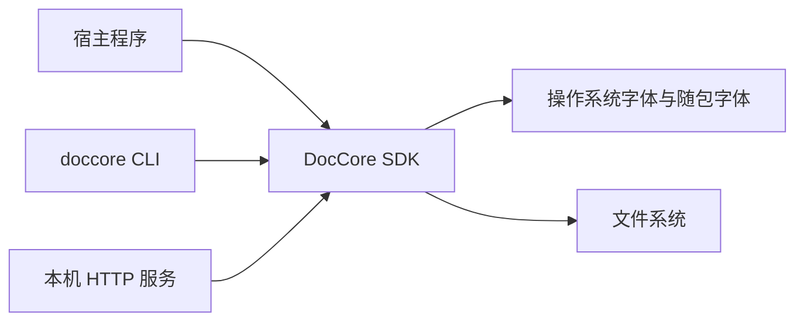
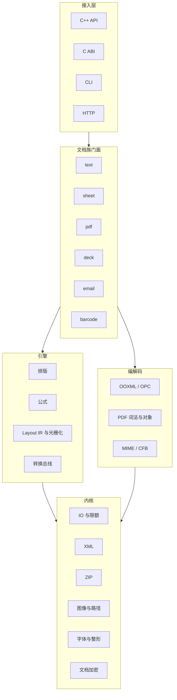
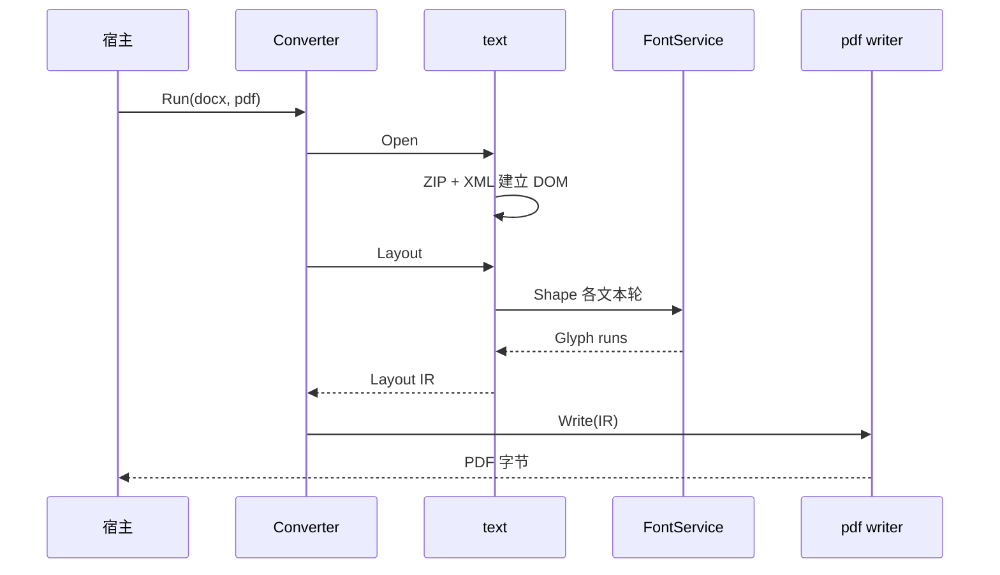
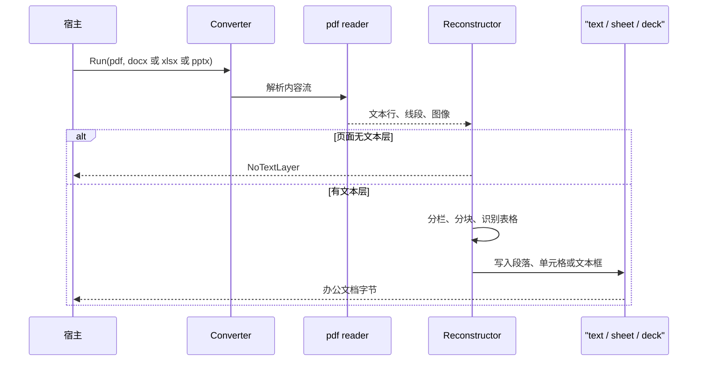
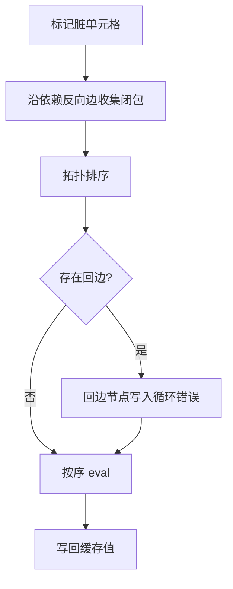

# DocCore — 详细技术设计书

| 项 | 内容 |
|----|------|
| 文档编号 | DOCCORE-TDD-001 |
| 版本 | 0.12 |
| 状态 | 待评审 |
| 关联需求 | [01-产品需求书.md](01-产品需求书.md) |
| 目标 | 把 DocCore 的 P0/P1 做成可实施的模块、接口与数据设计，并为 P2/P3 留下边界 |

## 1. 概述

DocCore 是进程内的文档引擎。宿主通过 C++ API、C ABI、CLI 或本机 HTTP 服务，完成办公文档的读取、编辑、计算、排版、转换和渲染。运行期不启动 Office 或 Acrobat。

**范围**

- 深入设计：内核、字处理、表格、PDF 生成与读取、PDF 重建为 DOCX/XLSX/PPTX、转换总线、CLI
- 接口级设计：演示文稿、邮件、条码、HTTP、许可、C ABI
- 只定边界：OCR、XPS/PS、项目计划、TeX、PUB、OMR

**P2/P3 边界（只定边界，本期不做设计）**

| 需求 | 边界 |
|------|------|
| F-111 DOC/RTF/ODT 读取 | 各自编解码器，接同一个 text DOM；不复用 OOXML 路径 |
| F-112 文档比较 | 在 text DOM 上做序列对齐并产出修订；不引入第三方 diff 引擎 |
| F-206 数据透视与扩展公式 | 透视缓存独立存储；扩展函数只增加 `FuncDesc` |
| F-304 表单、注释、签名 | 表单与注释进 pdf 对象模型；签名只验证不签发（见 3.1.7） |
| F-701 OCR | 进程内插件接口，核心库不链接识别引擎与数据文件 |
| F-802 XPS/PS/EPS | 页面描述解析后落到 Layout IR，复用 pdf 编码器 |
| F-803–F-806 项目计划、TeX、PUB、OMR | 各自独立模块，以可选包交付，不进默认链接目标 |

**设计原则**

1. 每种文档族拥有自己的 DOM。不把 Word 段落、单元格和幻灯片形状塞进同一棵树。
2. 固定版式输出统一走 Layout IR，再由 PDF、PNG、XPS 编码器消费。
3. 解析器对不可信输入防御：限额、禁外部实体、禁宏执行、有限递归。
4. 未识别的 OOXML 部件默认保留，避免“打开再保存”丢失自定义数据。
5. 公开 API 只使用 DocCore 类型。第三方库停留在内核内部。

## 2. 架构总览

### 2.1 系统上下文



SDK 不连接许可服务器、不连接云 OCR、不连接邮件服务器。HTTP 服务是 SDK 的薄封装，只在本机或显式配置的地址上监听。

### 2.2 逻辑分层



| 组件 | 职责 | 技术选型 |
|------|------|----------|
| kernel/io | 文件、内存、流；读写限额；临时文件 | 自研薄封装，C++20 `std::span` / 自有 `Stream` |
| kernel/zip | ZIP 读写、条目名规范化、压缩比限额 | miniz 或等价 BSD/MIT 实现 |
| kernel/xml | 只读拉取式 XML；写出拉流 | 自研拉取解析器。不展开 DTD 与外部实体 |
| kernel/opc | OOXML 包、内容类型、关系部件 | 自研，依据 ECMA-376 Pack URI 与关系部件 |
| kernel/font | 枚举、整形、双向算法、度量 | FreeType + HarfBuzz + 自带 UAX #9 实现；ICU 仅在自带实现达不到样本时引入（体积见第 6 节待决） |
| kernel/gfx | PNG/JPEG/GIF/TIFF/BMP 解码；路径与变换 | libpng、libjpeg-turbo、libtiff、giflib、自研路径光栅（或 Skia，见 ADR-004） |
| kernel/crypto | OOXML 敏捷加密、PDF 标准安全处理器、CMS 验签 | 自研协议层 + OpenSSL 3 或等价经过审查的实现（见 ADR-009） |
| text | 字处理 DOM、样式、排版 | 自研 |
| sheet | 稀疏表、公式、图表布局 | 自研 |
| pdf | PDF 对象图、内容流、生成与抽取 | 自研 |
| deck | 演示文稿 DOM、幻灯片形状树 | 自研 |
| render | Layout IR、字形运行、光栅化 | 自研 IR；光栅后端可替换 |
| convert | 格式矩阵与调度 | 自研 |
| cli / http | 进程入口 | CLI 无第三方框架；HTTP 用单文件嵌入式服务器或自研小实现 |

### 2.3 部署视图

| 模式 | 拓扑 | 说明 |
|------|------|------|
| SDK | 链入宿主进程 | 默认。无常驻守护进程 |
| CLI | 每任务一个进程 | 批处理由外部调度器循环调用，库本身不做队列 |
| HTTP | 单机单进程 | 工作线程数默认等于硬件并发数。无共享文档缓存 |

节点规格按需求书基准机评估单进程。水平扩展由宿主复制进程完成，DocCore 不内置集群。

发行布局：

```text
doccore/
  include/doccore/          公开头文件
  lib/                      动态库或静态库
  bin/doccore               CLI
  share/fonts/              可选，许可证允许时
  share/license-notices/    第三方声明
  cmake/doccore-config.cmake
```

### 2.4 源码目录

```text
src/
  kernel/       io zip xml opc font gfx crypto limit
  model/        跨族基础类型：颜色、长度、几何、日期
  text/
  sheet/
  pdf/
  deck/
  email/
  barcode/
  render/       layout_ir, raster
  convert/
  cabi/
  cli/
  http/
tests/
  gold/         样本与期望
  fuzz/         解析器语料
```

模块之间只允许向下依赖：`cli → convert → 文档族 → render/kernel`。文档族之间不互相包含头文件。DOCX 转 PDF 由 `convert` 调用 `text` 排版，再把 Layout IR 交给 `pdf` 写出。

### 2.5 线程与对象生命周期

- `Document`、`Workbook`、`PdfFile` 不是线程安全的。
- 只读快照可以跨线程：`Layout` 开始时记录 DOM 世代号并复制所需度量。排版期间源 DOM 被修改，则本次 `Layout` 返回 `InvalidArgument`，不产出部分 IR。需要并发修改时由调用方加锁或先克隆文档。
- 字体缓存、图像解码缓存是进程级、内部加锁。缓存可以淘汰，淘汰不影响已生成的 Layout IR（IR 持有字形 ID 与已解码像素的只读副本）。
- 取消令牌 `CancelToken` 按值复制，内部是原子标志。排版以“页”为检查点，公式以“计算批次”为检查点。

## 3. 详细设计

### 3.1 内核

#### 3.1.1 错误模型

公开 C++ API 使用异常 `doccore::Error`。C ABI 与 CLI 把异常转成错误码，不允许异常穿出 C 边界。

| 错误码 | 名称 | 含义 |
|--------|------|------|
| 0 | Ok | 成功 |
| 1 | Unknown | 未分类失败 |
| 2 | InvalidArgument | 参数不合法 |
| 3 | Unsupported | 格式或特性不支持 |
| 4 | NeedPassword | 缺少密码 |
| 5 | WrongPassword | 密码错误 |
| 6 | Corrupt | 结构损坏 |
| 7 | Io | 读写失败 |
| 8 | LimitExceeded | 触发安全或大小限额 |
| 9 | Cancelled | 调用方取消 |
| 10 | License | 许可无效或模块未购买 |
| 11 | Formula | 公式编译失败（单元格上的 #REF! 等不是这个错误） |

单元格计算错误（`#DIV/0!`、`#N/A`、`#VALUE!`、`#REF!`、`#NAME?`、`#NUM!`、`#NULL!`、`#GETTING_DATA` 不使用、另加 `#NIMPL!` 表示函数未实现）存在单元格里，不抛异常。

警告用 `Warning` 收集器：`code`、`module`、`path`（部件或页）、`message`。打开成功但有警告时不抛异常。

```cpp
namespace doccore {
struct Warning {
  int code;
  std::string module;
  std::string path;
  std::string message;
};

class WarningSink {
 public:
  virtual ~WarningSink() = default;
  virtual void Add(Warning w) = 0;
};

class CancelToken {
 public:
  void RequestCancel() noexcept;
  bool IsCancelled() const noexcept;
};
}
```

警告码按模块分段，一旦发布不复用。调用方按码判断，不解析 `message` 文本：

| 码 | 名称 | 触发 |
|----|------|------|
| 1001 | FontSubstituted | 文档指定字体不存在，使用回退字体 |
| 1002 | UnknownPartKept | 未识别 OOXML 部件按字节保留 |
| 1003 | MacroPreserved | 宏部件保留且未执行 |
| 1004 | FieldNotStabilized | 域更新 3 轮未收敛 |
| 1005 | ChartPlaceholder | 图表类型不受支持，按占位框输出（P0 全部图表） |
| 1006 | NumberFormatFallback | 数字格式未支持，退回通用格式 |
| 1007 | DrawOpSkipped | 未支持的绘制算子被跳过 |
| 1008 | PathDegraded | 虚线、渐变、裁剪降级为实线填充 |
| 1009 | ImageSkipped | 图像部件损坏，跳过该图 |
| 1010 | HeaderFooterUnsplit | 页眉页脚无法与正文分离，留在正文 |
| 1011 | NoTextLayer | PDF 无文本层（同时是 `Unsupported` 的原因） |
| 1012 | RebuildHeuristic | 重建使用了启发式（无框线表格、按列放置） |
| 1013 | ColumnWidthApproximated | 列宽由字符宽度近似 |
| 1014 | PermissionRestricted | 文档权限位限制编辑或抽取，按只读处理 |
| 1015 | ExternalEntityRejected | XML 外部实体被拒绝 |
| 1016 | LimitApproaching | 用量达到限额的 80% |
| 1017 | LicenseClockRollback | 系统时钟回拨，许可按过期处理 |

错误码到退出码的映射只在 `cli/exit_code.cpp` 一处实现，按需求书 6.2 的映射表把 0–11 折成 0/1/2/3/4/5/6，各模块不自行判断退出码。

#### 3.1.2 流

```cpp
class Stream {
 public:
  virtual ~Stream() = default;
  virtual int64_t Read(std::span<std::byte> dst) = 0;
  virtual void Write(std::span<const std::byte> src) = 0;
  virtual void Seek(int64_t pos) = 0;
  virtual int64_t Tell() const = 0;
  virtual int64_t Size() const = 0;
  virtual void Truncate(int64_t size);      // 默认实现抛 Unsupported
};
```

`FileStream`、`MemoryStream`、`LimitStream`（读满配额即失败）。ZIP 解压输出先进 `LimitStream`，避免先分配“声明的解压大小”。

`Truncate` 是转换失败回滚的前提：目标流必须同时可 `Seek` 与 `Truncate`（`FileStream`、`MemoryStream` 满足）。调用方传入只写不可回退的流时，`Converter::Run` 在写出任何字节之前返回 `InvalidArgument`，而不是写到一半再抛错。

临时文件：POSIX 用 `mkstemp` 语义；Windows 用 `CreateFileW` + `CREATE_NEW` + `FILE_ATTRIBUTE_TEMPORARY`，并显式设置只允许当前用户访问的 DACL。对象析构时删除。HTTP 与大文件 OOXML 解密使用临时文件；小于 32 MB 的包默认留在内存，阈值可配置。进程异常退出遗留的临时目录，在下次启动时按目录年龄清理（默认超过 24 小时）。

#### 3.1.3 ZIP 与 OPC

打开 OOXML 的顺序：

1. 读取 ZIP 尾部中央目录。条目数超过 65535 时必须走 ZIP64 的 EOCD 与扩展字段（需求书限额允许到 100 000 条目）；ZIP64 解析失败按 `Corrupt` 处理。
2. 不信任本地文件头里的大小，以中央目录的 `compressed_size`、`uncompressed_size` 为准；两者与实际解压计数不一致时以实际计数为准。
3. 拒绝绝对路径、盘符、`..` 段、反斜杠混用后的越界路径。同名条目重复出现时后者覆盖前者并警告。
4. 累计解压字节与条目数，超限抛 `LimitExceeded`。
5. 读取 `[Content_Types].xml` 与 `_rels/.rels`。
6. 按内容类型把部件交给对应解码器。解码器没注册的部件进入 `UnknownPart` 表，保存时原样写回。

关系 ID 在内存中用字符串保存。保存时可以重排部件压缩顺序，不承诺与输入 ZIP 字节一致。结构保真的测试比较 DOM 和未识别部件字节，不比较 ZIP 字节。

#### 3.1.4 XML

拉取式接口，调用方驱动：

```cpp
enum class XmlEvent { Start, End, Text, Empty };
struct XmlNodeView {
  XmlEvent event;
  std::string_view name;       // 仅在本次 Next 有效
  std::string_view text;
  // 属性通过 Attribute(name) 读取，同样只在 Start 时有效
};
class XmlReader {
 public:
  explicit XmlReader(Stream& in, const XmlLimits& limits);
  bool Next(XmlNodeView& out);
};
```

限额：最大深度 64、单个名称 4 KB、单个文本节点 64 MB、总文本 2 GB。遇到 `<!DOCTYPE` 直接拒绝。不解析实体引用以外的五个预定义实体（`&lt; &gt; &amp; &quot; &apos;`）。数字字符引用允许，限制在 Unicode 标量值。

写出使用 `XmlWriter`，负责转义。命名空间由各解码器显式写出，避免全局重写前缀导致未识别部件对不上。

#### 3.1.5 字体子系统

```cpp
class FontService {
 public:
  void AddFolder(const std::filesystem::path& dir);
  FontMatch Match(const FontQuery& q) const;   // 家族、粗细、斜体、字符
  ShapedRun Shape(const FontMatch& font, std::u32string_view text,
                  double size_pt, const BidiOptions& bidi) const;
};

struct Glyph {
  uint32_t glyph_id;
  uint32_t cluster;     // 对应 UTF-32 下标
  float x_advance;
  float x_offset;
  float y_offset;
};
struct ShapedRun { std::vector<Glyph> glyphs; };
```

匹配顺序：文档指定家族 → 调用方配置的回退链 → 按字符覆盖选择（缺字则换字体，称为字体回退分段）。每次替换写一条警告。

整形调用 HarfBuzz。双向算法在整形前把段落切成方向段。PDF 写出使用逻辑顺序的 Unicode 与 ToUnicode 表，视觉位置来自字形前进宽度。这样搜索得到的是逻辑字符串。

度量单位：排版内部使用 EMU（英文公制单位，1 pt = 12700 EMU）的 64 位整数，避免段落宽度累加漂移。对外 API 用点数 `double`，在边界转换一次。

#### 3.1.6 图像

解码结果：

```cpp
struct Bitmap {
  int width;
  int height;
  int stride;
  enum class Pixel : uint8_t { Gray8, Rgb8, Rgba8 } pixel;
  std::vector<std::byte> pixels;
};
```

解码分工：PNG 用 libpng；JPEG 用 libjpeg-turbo（含 CMYK 与 12 位到 8 位的降位，CMYK 转 RGB 有 ICC 时按 ICC，无配置时按经验公式）；GIF 用 giflib（取首帧，动画帧丢弃并警告）；TIFF 用 libtiff（只支持常见基线压缩，多页取首帧并警告）；BMP 自研。

EMF/WMF 在 P0 转为内部路径列表（直线、贝塞尔、文字、位图块）。转换不了的记录跳过并警告，不把整个文件交给 GDI 播放，以保证 Linux 行为一致。PDF 直通路径不受此限：JPEG 源无裁剪无透明时作为 DCT `XObject` 原样嵌入，不做解码再编码。

#### 3.1.7 文档加密

OOXML 敏捷加密按 ECMA-376 实现：从加密信息部件读出算法、盐、旋数和密钥长度，派生密钥后解密包内加密流。算法不在支持表内则返回 `Unsupported`，不回退到弱算法除非文件明确如此声明且选项允许打开遗留加密。

**写加密（F-110，P1）**：保存时生成新的加密信息部件——随机 16 字节盐、随机 `encryptedVerifier` 与 `encryptedVerifierHash`、`spinCount` 默认 100 000，算法固定为 AES-256-CBC + SHA-512（与 Office 2013 之后的默认一致），再按 4 KB 分段加密包内各部件。`SaveOptions.password` 为空表示不加密。只读保护（`w:documentProtection`）是独立选项，写入 `settings.xml`，不与加密混用。

PDF 打开支持标准安全处理器的修订版本 2–5 中文档声明的那种；遇到修订版本 6（PDF 2.0 的 AES-256）返回 `Unsupported` 并警告，不猜算法。PDF 写出加密（F-303，P1）支持 R4（RC4 128 位）与 R5（AES-256），按 `PdfSaveOptions.user_password`、`owner_password`、`permissions` 生成 `/Encrypt` 字典；目标为 PDF/A 时禁用加密并返回 `InvalidArgument`。

签名验证在 P2 使用独立的 CMS 验证路径，验证失败只反映在签名状态上，不影响其余内容是否允许被读取（由文档权限位决定，默认无密码则只读打开已授权内容）。

密码只存在于栈上的 `std::string` 或调用方缓冲区。日志接口不接受密码字段。

### 3.2 版式中间表示

Layout IR 是排版器的输出、PDF/PNG 编码器的输入。它已经完成换行、分页和坐标计算。

```cpp
struct LayoutPage {
  double width_pt, height_pt;
  std::vector<DrawOp> ops;
  std::vector<Link> links;        // 可点击区域
  std::vector<NamedDest> dests;   // 落在本页的命名目标
};

struct LayoutDocument {
  std::vector<LayoutPage> pages;
  std::vector<Bookmark> bookmarks;  // 按出现顺序的扁平大纲，用 level 表达层级
};

struct Link {
  double x, y, w_pt, h_pt;  // 左上原点，单位 pt
  std::string uri;          // 外部 URI；为空表示文档内跳转
  std::string dest;         // 内部命名目标（书签名）；为空表示外部链接
};

struct NamedDest { std::string name; double x, y; };

struct Bookmark { std::string title; int level; int page; double y; };

struct DrawText {
  FontKey font;
  double size_pt;
  Rgba color;
  double x, y;                 // 基线起点
  std::string text_utf8;
};

struct DrawImage { ImageData image; double x, y, w_pt, h_pt; };
struct DrawPath  { std::vector<PathVerb> verbs; bool has_fill; bool has_stroke;
                   Rgba fill, stroke; double stroke_pt; };

using DrawOp = std::variant<DrawText, DrawImage, DrawPath>;
```

坐标原点在页面左上，Y 向下。PDF 编码器负责换成 PDF 用户空间（原点左下）。

IR 不回指 DOM。超链接携带目标 URL 或命名目标名，足够写出注释。页眉页脚在生成 IR 时已经画进对应页，不再是独立故事。

水印在 IR 生成的最后追加，作为每页最上层的 `DrawText` 或 `DrawPath`（半透明），因此 PDF、PNG、XPS 三个输出共享同一实现，不需要各编码器各写一遍。DOCX、XLSX、PPTX 目标没有固定版式，改为写入页眉或首行文字，见 3.10。

#### 3.2.1 链接、命名目标与大纲的产出与序列化

`links`/`dests`/`bookmarks` 是三条文档族共用的出口，各族的来源不同：

| 文档族 | 链接来源 | 大纲来源 |
|--------|----------|----------|
| Word | `w:hyperlink/@r:id`（外部）、`@w:anchor`（内部，落点由 `w:bookmarkStart` 变成 `NamedDest`） | 段落 `w:outlineLvl`，缺失时按样式名 `heading N`/`标题 N` 推断 |
| Excel | `<hyperlink @r:id>`（外部）、`@location`（内部，如 `Sheet2!A1`） | 每张工作表一条 |
| PPT | `a:rPr/a:hlinkClick` 的 run 级 URL | 每页幻灯片的标题占位符文本，缺失时退化为 `Slide N` |

内部跳转的落点要等全部页排完才知道，所以 Excel 采用三遍：① 扫所有 `@location` 收集「被引用的 (行,列)」；② 排每张表，把命中集合的单元格落点（页号 + x/y）记下来；③ 把 `location` 原文当作目标名写进对应页的 `dests`，与链接的 `dest` 对齐。

PDF 写出的三块结构：

- **链接注释**：`/Annots [ << /Type /Annot /Subtype /Link /Rect [x0 y0 x1 y1] /Border [0 0 0] /A << /S /URI /URI (…) >> >> … ]`，内部跳转用 `/A << /S /GoTo /D /name >>`（名字对象，指向 catalog 的 `/Dests`）。矩形由 IR 的左上原点坐标换算：`y0 = 页高 - y - h`，`y1 = 页高 - y`。
- **命名目标**：两种形式同时写，兼容面最大。PDF 1.1 形式 `catalog /Dests << /name [页 /XYZ x y null] >>`（供 `/D /name` 引用），PDF 1.2+ 形式 `catalog /Names /Dests << /Names [(name) [页 /XYZ x y null]] >>` 名字树（供 `/D (string)` 引用）。只写名字树会被部分实现（如 PyMuPDF 的旧式解析分支）误当成 1.1 字典而解析失败。
- **大纲**：`catalog /Outlines` 指向根节点，扁平表按 `level` 建树，每个节点写 `/Title`、`/Parent`、`/Prev`、`/Next`、`/First`、`/Last`、`/Count`（打开状态下为后代总数）、`/Dest [页 /XYZ 0 y null]`。建树用「父节点下标 + 1」作槽位的 `first_of`/`last_of` 数组，顶层（槽位 0）与子层走同一套链接逻辑——只处理子层会漏掉顶层兄弟的 `/Next`，导致只有第一支出现在阅读器里。

文本字符串（书签名、URI）按 PDF 32000-1 §7.9.2 处理：纯 ASCII 走字面量并转义 `(`/`)`/`\`，含非 ASCII 时改写成 UTF-16BE + BOM 的十六进制字符串 `<FEFF…>`，中文标题与中文 URI 才能被阅读器正确还原。名字对象（`/Name`）按 §7.3.5 用 `#XX` 转义分隔符与非 ASCII 字节。

#### 3.2.2 PDF 注释的读写

读：`PdfPage::annotations()` 惰性解析页面 `/Annots`，覆盖 Text、Link、FreeText、Line、Square、Circle、Polygon、PolyLine、Highlight、Underline、Squiggly、StrikeOut、Stamp、Caret、Ink、Popup、FileAttachment、Sound、Movie、Widget、Screen、PrinterMark、TrapNet、Watermark、3D、Redact 共 26 个子类型。字段落地到 `PdfAnnotation`：`/Rect`（规范成左下角 + 宽高，原文顶点顺序不保证）、`/C`（1/3/4 分量都见过，统一折成 0xRRGGBB）、`/CA`、`/F`、`/T`、`/Contents`、`/Subj`、`/M`、`/NM`、`/Name`、`/Open`、`/QuadPoints`、`/AP` 存在性。认不出的子类型保留 `subtype_name` 原文，不丢信息。

写：`AddAnnotations(PdfFile&, annots)` 走**增量更新**（§7.5.6），不做整体重写：

- 为什么不做整体重写：重写要把每个对象重新序列化，字体子集、图像流、加密字典、对象流都可能被无意改变。增量更新只做三件事——原文件字节原样保留、追加新对象、给受影响的页面字典写一个新版本，最后追加一个带 `/Prev` 的 xref 段。原有内容流一个字节都不动。
- 每条注释生成自己的外观流（`/AP /N`，Form XObject，`/BBox [0 0 w h]`，与 `/Rect` 同尺寸所以映射是纯平移）。不生成外观流的话 Highlight/Square 在多数阅读器里显示成空白。Square 描边、Circle 四段贝塞尔（k = 4/3·(√2−1)）、Highlight 用 `/ExtGState << /BM /Multiply /ca 0.55 >>` 做正片叠底半透明、Underline/StrikeOut/Squiggly 画对应线型、FreeText 与 Stamp 用标准 14 字体里的 Helvetica（无需嵌入）、Text/Popup 交给阅读器画图标。
- 页面字典改写：复制原字典、去掉旧 `/Annots`、把既有注释引用与新注释引用接起来，用**同一个对象号**写一个新版本。同一个对象号在增量段里出现多次时只保留最后一次的偏移。
- 结尾写传统 xref 表（对象 0 的 free 项 + 每个新写对象的 20 字节条目，连续对象号合成一个子段），`trailer` 带 `/Size`（最大对象号 + 1）、`/Root`、`/Info`、`/ID` 与 `/Prev`（指向原 startxref）。
- 拿不到可用 xref（`startxref == 0`）时抛 `Unsupported`：这种情况下写增量段会让旧对象在新表里"消失"，宁可拒绝。
- 页号越界只发 `AnnotSkipped` 告警并跳过该条，不中断整批。

#### 3.2.3 PDF 加密的解密链路

阅读加密 PDF 的难点不在算法本身，而在**密钥派生的细节容错**：同一份 32000-1 文本，不同生成器在 `/Length` 单位、`/CF` 缺省、所有者口令回退上的写法都不一样，任何一处偏差都表现为"口令正确但解出来是乱码"，很难定位。因此这一层按"先认证、再解密"两段拆开，认证失败一律抛 `NeedPassword`，绝不让半解密的数据流进正文。

覆盖四种组合（`src/pdf/pdf_crypt.cpp`）：

| `/V` | `/R` | 算法 | 密钥长度 | 说明 |
| --- | --- | --- | --- | --- |
| 1 | 2 | RC4 | 40 位（5 字节） | 最老的一档，`/Length` 常常缺省 |
| 2 | 3 | RC4 | 128 位（`/Length`/8） | 50 轮 MD5 强化 |
| 4 | 4 | RC4 或 AES-128 | 按 `/CF` 的 `/CFM` | `V2` = RC4，`AESV2` = AES-128-CBC |
| 5 | 5/6 | AES-256 | 32 字节 | `R6` 用 Algorithm 2.B 迭代哈希 |

要点：

- **算法 2**（文件密钥）：`MD5(填充口令 ‖ /O ‖ /P 小端 ‖ /ID[0] [‖ 0xFFFFFFFF 若 /EncryptMetadata false])`，`R3+` 再把结果自身取 MD5 迭代 50 轮，最后截到密钥长度。`/P` 必须是 4 字节**小端有符号**，写成大端是这类实现最常见的错。
- **算法 3.A**（算 `/U`）：`R2` 直接用文件密钥 RC4 填充串；`R3+` 是 `MD5(填充串 ‖ /ID[0])` 再 RC4，然后用"密钥逐字节异或 i"做 19 轮。比较时 `R2` 比 32 字节、`R3+` 只比前 16 字节——后 16 字节是任意填充，比了必错。
- **算法 6**（所有者口令）：先用**填充后**的所有者口令做 MD5（`R3+` 迭代 50 轮）得到 RC4 密钥，反向解密 `/O`（`R2` 一轮，`R3+` 从 i=19 递减到 0 共 20 轮）还原出填充过的用户口令，再用它走一遍算法 2 与 3.A 校验。这一步漏掉"先填充"就会让所有者口令永远失败，而用户口令完全正常——症状极具误导性。
- **算法 1**（每对象密钥）：`MD5(文件密钥 ‖ 对象号 3 字节小端 ‖ 代次 2 字节小端 [‖ "sAlT"])`，截到 `min(16, 密钥长度+5)`；`sAlT` 只在 AES 过滤器下追加。
- **算法 2.B**（`R6`）：`K = SHA-256(口令 ‖ 盐 ‖ udata)`，然后循环 64 次以上：把 `口令 ‖ K ‖ udata` 复制 64 份做 AES-128-CBC（不补填充）加密，按密文前 16 字节之和模 3 选 SHA-256/384/512 重新哈希，直到最后一轮且密文末字节 ≤ 轮次−32。`R5` 就是单次 SHA-256。
- **解密时机**：放在 `ResolveRef` 里，对象一取出来就解，`cache` 里存的是明文——上层（正文抽取、字体、图像、重建器）完全不需要知道加密存在。`/Encrypt` 字典自身的对象号要排除；`/Type /XRef` 的交叉引用流永远不加密；`/EncryptMetadata false` 时 `/Type /Metadata` 的流也不解密。
- **过滤器选择**：字符串走 `/StrF`、流走 `/StmF`，两者都可以是 `Identity`（不加密）。`V4` 偶尔出现没写 `/CF` 但 `/R4` 的文件，按 AES-128 兜底。
- **权限位**：`/P` 的 1 基位号 3..12 折成 `PdfPermissions`（打印、改内容、复制、注释、填表、无障碍提取、装订、高质量打印）。未加密文档返回全 true，符合阅读器惯例。

密码学原语（MD5、SHA-256/384/512、RC4、AES-128/192/256、CBC、PKCS#7）全部自实现，放在 `src/kernel/crypto.cpp`，只用 RFC/FIPS/NIST 标准向量校验，不依赖 OpenSSL——避免引入外部链接依赖，也让"零依赖"这条约束在加密路径上同样成立。

验收方式刻意做成**交叉验证**：夹具由 PyMuPDF（MuPDF）加密，DocCore 只负责解密，两套实现独立；再把 DocCore 抽出的正文落盘，与 PyMuPDF 抽出的正文去空白后逐字比对。自己加密自己解密是对称的，两边的同类错误会互相抵消，测不出任何东西。

### 3.3 字处理

#### 3.3.1 DOM

```text
Document
  styles: StyleSheet
  numbering: NumberingStore
  sections: Section[]
  footnotes, endnotes, comments
  bookmarks, content_controls
  watermark?, protection?
  unknown_parts

Section
  page: PageSetup          纸张、边距、方向、分栏、页码起始
  headers, footers         首页 / 奇数 / 偶数，可链接到上一节
  body: Block[]

Block = Paragraph | Table | BlockContentControl
Paragraph
  style_id, direct_format, numbering?
  keep_next, keep_lines, widow_control
  outline_level?           # 由样式或直接格式解析得到，供 TOC 与 PDF 大纲使用
  inlines: Inline[]
Inline = Run | Field | Drawing | Break | NoteRef | InlineContentControl
Run
  text: u32string
  direct_format

Table
  grid: ColumnWidth[]
  rows: Row[]
Row
  cells: Cell[]
Cell
  blocks: Block[]
  span_right, span_down
```

节点用 `unique_ptr` 组成树，父指针为裸观察指针，仅在树内有效。对外编辑 API 返回对象引用，引用在该节点被删除前有效。文档析构后引用失效。不把节点暴露成共享所有权，避免图结构循环。

```cpp
class Document {
 public:
  static Document Open(const OpenOptions& opt);
  static Document Create();
  void Save(const SaveOptions& opt) const;

  Section& AddSection();
  Builder Build();                       // 光标式写入
  LayoutResult Layout(const LayoutOptions&, CancelToken&);
  void UpdateFields(CancelToken&);
  MailMergeResult MailMerge(const DataTable&, const MailMergeOptions&);

  void AcceptAllRevisions();
  void RejectAllRevisions();
  ContentControl* FindContentControl(std::string_view tag);
  std::vector<Bookmark> Bookmarks() const;
  void SetWatermark(const WatermarkOptions&);
  void SetProtection(const ProtectionOptions&);
};
```

`AcceptAllRevisions` 就地折叠 `w:ins`/`w:del` 并清除修订标记；`FindContentControl` 按 `w:tag` 查找，返回可写控件节点，赋值走 `ContentControl::SetText`。

`Builder` 维持当前段落与格式，提供 `Write`、`Writeln`、`InsertImage`、`StartTable`。它只改 DOM，不排版。

#### 3.3.2 样式解析

有效字符格式 = 文档默认 → `basedOn` 链从根到叶 → 段落样式 → 编号级别字体 → 字符样式 → 直接格式。后写覆盖前写。

打开时检测 `basedOn` 环。发现环则断开环边、记警告、继续。解析时深度超过 16 同样断开。

列表：`abstractNum` 定义级别，`num` 实例引用它。段落只存编号实例 ID 和级别。

#### 3.3.3 读 DOCX

`word/document.xml` 用拉取解析器映射到 DOM。映射表（节选）：

| OOXML | DOM |
|-------|-----|
| `w:sectPr` | 结束当前节并写入 `PageSetup` |
| `w:p` / `w:r` / `w:t` | Paragraph / Run |
| `w:tbl` / `w:tr` / `w:tc` | Table / Row / Cell |
| `w:drawing`、`w:pict` | Drawing，图像字节从关系部件读取 |
| `w:fldChar`、`w:instrText` | Field，指令文本保留 |
| `w:ins`、`w:del` | Revision 标记挂在 Run 上 |
| `w:sdt` | ContentControl |
| `w:bookmarkStart` / `w:bookmarkEnd` | Bookmark，供 REF、TOC 与 PDF 大纲使用 |
| `w:footnoteReference` / `w:endnoteReference` | NoteRef，指向 footnotes / endnotes 集合 |
| `w:commentRangeStart` / `w:commentRangeEnd` / `w:commentReference` | Comment 及其锚定范围 |
| `w:headerReference` / `w:footerReference` | 节的页眉页脚部件与类型（默认 / 首页 / 偶数页） |
| `w:sectPr/w:cols`、`w:pgNumType` | 分栏与页码起始 |

`w:tblGrid` 缺失时，按单元格宽度和网格跨度重建列网格；重建失败则均分可写宽度并警告。

#### 3.3.4 排版算法

输入 DOM 与 `FontService`，输出 `vector<LayoutPage>`。

页面内容框宽度：

```text
content_width = page_width - margin_left - margin_right
分栏时每栏宽度 = (content_width - gap * (n - 1)) / n
```

段落排版（贪心换行，P0）：

```text
function layout_paragraph(p, column):
    runs = shape_all_inlines(p)          # 得到字形与不可断簇
    line = empty
    for cluster in runs:
        if cluster is break_opportunity and line.width + cluster.width > column.width:
            emit(line)
            line = empty
        append cluster to line
    emit(line)
    apply spacing before/after, line spacing, first-line indent
```

断行机会按 UAX #14。中文在字符间可断，连续拉丁字母默认在空白和连字符处断。P0 不做断词连字符。字形簇（由 HarfBuzz cluster 界定）不可拆开。

分页：

```text
y = content_top
for block in section:
    if block.page_break_before or keep_with_next overflows:
        new_page()
    if block is table:
        layout_table_split_rows()
    else:
        place paragraph lines, splitting between lines
    honor widow/orphan when the option is on (default on):
        a widow/orphan violation moves exactly 1 line, then re-checks
    honor keep_with_next: a run of paragraphs marked keep_with_next
        moves to the next page as a unit, up to 32 paragraphs
    honor keep_lines: a paragraph that cannot fit whole moves whole
```

表格行默认允许跨页拆分时，按单元格内块拆开；不允许时整行下移。行高为各单元格内容的最大值，加上单元格边距。嵌套表作为单元格里的块递归排版，递归深度上限 16。

浮动图 P0 支持“上下型”和“四周型”的简化规则：图占一个矩形障碍，文字线在障碍左右找剩余宽度，剩余宽度小于 2 个汉字则整行移到障碍下方。锚点在段落内。页边距外的浮动位置夹紧到内容框并警告。

页眉页脚在正文分页完成后，按节属性选择首页或奇偶页故事，单独排进页面顶底边距区。页码在这一步已知，写入页眉中的 PAGE 域结果。

**脚注与尾注**

脚注区在每页内容框底部，按本节脚注引用出现的顺序排列。脚注区高度取决于本页落下几条脚注，脚注条数又取决于正文能排多少行，因此按下式迭代（最多 4 轮，未收敛取最后一轮并警告）：

```text
reserve = 0
loop:
    body_bottom = content_bottom - reserve
    place body blocks until body_bottom
    notes = 本页被引用的脚注
    need = 分隔线高度 + sum(note heights) + note_spacing * (n - 1)
    if need == reserve: break
    reserve = need
```

单条脚注高过整页时，把该脚注拆到下一页续排，续排部分不重复编号、不重复引用标记。编号格式取 `w:footnotePr` 的 `numFmt`，P0 支持十进制与每页重编。尾注统一排在文档末尾的新节，复用同一套区域排版逻辑，只是区域高度为整页。脚注文本本身也走 `layout_paragraph`，宽度为脚注区宽度减去编号缩进。

域更新：

```text
function update_fields(doc):
    for i in 1..3:
        layout = layout(doc)
        dirty = false
        for field in doc.fields:
            new_result = eval(field, layout)    # PAGE、NUMPAGES、DATE、REF、HYPERLINK、TOC、IF、MERGEFIELD、MERGEREC
            if new_result != field.cached_result:
                field.cached_result = new_result
                dirty = true
        if not dirty:
            return layout
    warn("fields did not stabilize")
    return layout
```

TOC 收集大纲级别大于 0 的段落的文本和页码。P1 才启用此循环；P0 导出时只更新 PAGE 和 NUMPAGES，因为这两项不改变分页。未实现的域保留缓存结果并警告，不静默清空。

#### 3.3.5 邮件合并

数据表是调用方传入的列式记录，不读取数据库。

```cpp
struct DataTable {
  std::vector<std::string> columns;
  std::vector<std::vector<std::string>> rows;
};
```

合并复制 DOM：对每一行克隆模板，把 `MERGEFIELD` 的结果显示替换为对应列。`TableStart`/`TableEnd` 区域按行展开表格行。模板文档不被修改。未知字段替换为空并警告。

#### 3.3.6 保存 DOCX

从 DOM 生成 `document.xml`、`styles.xml`、`numbering.xml`、关系与内容类型。`UnknownPart` 按原路径写入。图像重新进入 `word/media/`，关系 ID 重新分配，同时更新引用。宏项目部件若 DOM 标记为保留，则原样拷贝，引擎不解析 VBA 字节码。

#### 3.3.7 水印与文档保护

**水印不是独立元素。** Word 的水印是页眉里的一个 VML 形状：`w:pict` 里放 `v:shape`，形状挂 `v:textpath`（文字）或 `v:imagedata`（图片），再加 `o:Watermark` 扩展属性，`z-index` 为负值压到正文下面。所以它既不进 `document.xml`，也不能靠"找水印元素"找到——必须从页眉里认。

读侧（`docx_read.cpp`）：

- 只在页眉部件里找，而且**只认明确带水印标记的形状**（`id` 含 `watermark`，或带 `Watermark` 属性）。页眉里还可能有普通图片和艺术字，误吞的代价是把正常内容吃掉。
- 文字水印的正文在 `v:textpath/@string`；字体、粗斜体在 `v:textpath/@style`（一串 CSS，`font-family`/`font-size`/`font-weight`）；旋转、盒宽高在 `v:shape/@style`（`rotation:315;width:527.85pt;height:105.57pt`）；颜色在 `v:shape/@fillcolor`；半透明在 `v:fill/@opacity`。
- 认出之后把承载它的那个段落**从页眉排版流里摘掉**（纯图形、无文字的段落）。否则水印会被当成一张普通页眉图片再排一次。
- 图片水印的字节直接读进 DOM（`Watermark::image_bytes`），写回时不必依赖 `unknown_parts` 的顺序。

**字号是由盒子拉伸出来的，不是写死的。** Word 把文字水印写成 `font-size:1pt` + `fitshape="t"`，真实字号等于"把这段文字拉伸到形状盒宽度"所需的字号。所以排版时先在 1pt 下量一次文本宽度，再按 `盒宽 / 单位宽` 反推字号——这样任何纸型、任何字数都能得到 Word 的观感。盒宽缺省取页宽的 0.8868 倍（Word 在 A4 上写的就是 527.85pt），高宽比固定 5:1。

写侧（`docx_write.cpp`）：整段 VML 按原文拼字符串，不走通用的 XML 构造器——VML 的前缀混用（`v:shape` 的 `style` 不带前缀、`o:spid` 带前缀），交给自动加前缀的构造器只会写错。两块 `shapetype` 样板（`_x0000_t136` 艺术字、`_x0000_t75` 图片框）照抄 Word 的输出，不自创形状：自创形状 Word 能显示，但打印与导出 PDF 会走不同分支。

页眉载体：本节原本没有页眉时，写侧合成一个只含水印的默认页眉部件，并在 `sectPr` 里补 `headerReference w:type="default"`。图片水印还要额外写 `word/media/watermark1.<ext>`、页眉部件的 `_rels`、以及 `[Content_Types].xml` 里按扩展名的 `Default`。

**排版**：`DrawText` 增加 `rotate_deg`（绕基线起点旋转，逆时针为正，单位度）。IR 是 y 向下的坐标系，视觉逆时针 θ 对应 `x' = x·cosθ + y·sinθ`、`y' = -x·sinθ + y·cosθ`；PDF 写出时 `Tm` 用 `[cosφ sinφ -sinφ cosφ]`，两边视觉方向一致。Word 的 `rotation` 是顺时针为正，所以 `φ = -rotation`。水印排在每页 `ops` 的最前面（PDF 里后画的在上，所以最先画的在最底层）。图片水印按盒宽缩放居中，`washout` 用"往白色拉 + 压不透明度"近似 Word 的 `gain`/`blacklevel`。

**文档保护**只存口令的迭代哈希，口令本身不在文件里（ISO 29500-1 §17.15.1.29）：

```text
H0 = H(salt ‖ UTF-16LE(password))
Hi = H(H(i-1) ‖ uint32_le(i-1))        i = 1..spinCount
存储值 = base64( H(spinCount)[0 .. hashSize) )
```

`H` 按 `w:algorithmName` 选 SHA-1/256/384/512（缺省 SHA-1）；`w:cryptAlgorithmSid` 用的是 CryptoAPI 的 ALG_ID 尾号（3=MD5、4=SHA-1、12=SHA-256、13=SHA-384、14=SHA-512），不是 ST_Algo 的序号——这一点写错会让所有 Word 2007 的文件校验失败。迭代 10 万次是常态，所以校验一次要跑十万次哈希，调用方自己决定要不要缓存结果。

`settings.xml` **不做整体重写**：原文整段存进 `Document::settings_xml`，写回时只做补丁式替换（先按本地名删掉旧的 `documentProtection`/`writeProtection`，再在根元素开始标签后插入新的）。里面还有大量我们没建模的开关（兼容性、语言、修订参数、缩放比例），重建一份必然丢东西。同一个元素出现两次时 Word 行为不确定，所以插入前必须删干净。

哈希属性写两套名字（`hash`/`salt` 与 `hashValue`/`saltValue`）：前者是 Word 2007+ 的写法，后者是 2013+ 的写法，不同版本的读取方各认一套。

### 3.4 电子表格

#### 3.4.1 存储

工作表不用二维大数组。

```cpp
struct Cell {
  enum class Kind : uint8_t { Empty, Number, Text, Bool, Error, Formula } kind;
  union {
    double number;
    bool boolean;
    int32_t text_id;     // 共享字符串或内联字符串池
    int16_t error_code;
  } v;
  int32_t style_id;
  int32_t formula_id;    // -1 表示无公式
};

class Worksheet {
  // 稀疏存储：列号 → 该列已用行（行号升序）。一列一个 map 已经足够稀疏；
  // 块化（每 1024 行一块）只作为后续优化，不改变对外语义与迭代顺序。
  std::map<int32_t, std::map<int32_t, Cell>> columns;
  std::vector<double> col_widths;      // 未设置的列宽取默认值
  std::map<int32_t, double> row_heights;
};
```

`std::map` 在 P0 足够。若性能门禁失败，列索引再换为按列号排序的向量加二分查找。空单元格不存储。

共享字符串：打开时读 `sharedStrings.xml` 进池；保存时只写出仍被引用的项。内联字符串同样进池以便去重，保存格式按原单元格属性决定内联还是共享。

日期在单元格里是序列数加数字格式。数字格式解析 P0 支持：整数、小数位（含 `#,##0.00` 的千分位）、百分号、货币前后缀（`¥`、`$`、`€`、`CNY` 等按字面写出，不做汇率或区域换算）、日期时间（`yyyy-mm-dd`、`yyyy/m/d`、`hh:mm:ss`）、文本（`@`）。分数、科学计数、条件颜色段（`[Red]`）与自定义占位符在 P1 补齐；无法识别的格式原样保留，显示时退回通用格式并警告 `NumberFormatFallback`。

#### 3.4.2 公式

公式文本以 `=` 开头，解析为 AST。

```text
Expr = Number | String | Bool | Error
     | Ref Sheet? Cell
     | Range Ref : Ref
     | Name
     | Unary | Binary
     | Call ident '(' args ')'
```

解析器为递归下降，运算符优先级遵循 Excel：范围、一元、百分号、幂、乘除、加减、连接、比较。比较结果是布尔。

依赖图：

- 节点是单元格或名称
- 边是“我引用了谁”
- 重算时从脏单元格沿反向边传播
- 全表重算则按拓扑序计算
- 拓扑中的回边构成循环。未开启迭代时这些单元格得到循环错误

```text
function recalc(book, dirty_set):
    nodes = closure of dependents(dirty_set)
    order, cycles = topo(nodes)
    for c in cycles: set_error(c, CYCLE)
    for n in order:
        if n in cycles: continue
        n.value = eval(n.ast, book)
```

`eval` 对区域参数按函数需求传递，不先把区域物化成值数组，除非函数语义需要（例如 SUM 遍历非空单元格）。SUM 跳过文本。VLOOKUP 的第一参数与首列比较，`range_lookup` 为假时精确匹配，为真时要求首列升序，否则结果未定义并返回 `#N/A` 同时警告（P0 不默默给出错误近似）。

函数表是编译期注册的：

```cpp
struct FuncDesc {
  std::string_view name;
  int min_args;
  int max_args;
  Value (*call)(Context&, std::span<const Value>);
};
```

P0 函数集合以需求书 F-202 为准。未注册名字求值为 `#NAME?`。`TODAY` 从 `Context` 取本次计算的时间戳。

公式与值一起保存：`v` 存缓存值，`f` 存公式。打开后默认不重算，直到调用 `Recalculate` 或导出选项 `recalculate=true`。这样与“打开文件先看到上次保存的缓存”一致，也避免只读抽取时意外改动易变函数。

#### 3.4.3 导出 PDF

按打印设置分页：纸张、方向、页边距、适应页宽、打印区域、重复标题行。每个单元格变成 Layout IR 的文本与边框路径。列宽从字符宽度近似换成点数：`width_pt = TruncateToPixels(width_char * 8) * 72 / 96`，与 OOXML 列宽约定对齐，并在黄金样本里校正。

图表（P9 起，按 F-205 实现）：`Chart DOM` 保存类型、系列、分类、标题、图例与锚点。读取时按 `sheet → drawing → chart` 的关系链解析，**并把 drawing/chart 部件连同各自的 `.rels` 一并保留**——只留部件字节会让关系丢失，回写后第三方（openpyxl）读不到图。导出时在图表矩形内生成柱、条、折线、面积、散点、饼、环形的 `DrawPath` 与标签 `DrawText`，纵轴按"好看的刻度"定标。堆叠柱按**分类**竖向累加、纵轴上限取每类合计。P0 遇到图表则按锚点尺寸画占位矩形（斜线填充加"图表未渲染"文字）并警告 `ChartPlaceholder`，不丢弃图表部件字节。渲染正确性由独立验证器 `tests/verify_chart_pdf.py` 按 150 DPI 像素反推校验（柱高/张角与数据成比例），不依赖 DocCore 自身代码路径。

条件格式（F-205 同条）：`Workbook` 持 `dxfs` 差异格式表，`Worksheet` 持 `conditional_` 列表（`ConditionalFormat{range,rules}`，`ConditionalRule` 含 `type∈{CellIs,Expression}`、`op`、`operands`/`formula`、`dxf`、`priority`）。读取时按 `sheet → styles.xml <dxfs>` + `<conditionalFormatting sqref>` 解析（dxf 填充色在 `<bgColor>`）；写入时回写 `<dxfs>` 与 `<conditionalFormatting>`，`dxfId` 按 fill/font_color/bold 去重。渲染时 `DrawPage` 对每个单元格先调 `MatchedConditionalDxf`，命中则用差异格式的 `fill`/`bold`/`font_color` 覆盖底纹/字重/字色。求值器支持 cellIs 数值比较与 expression 公式（公式相对区域首格书写，渲染/求值时按当前格坐标平移相对引用）。验收见 `TestConditionalFormat`（夹具 `sample_cf.xlsx`，`B2:B6` 上 `greaterThan 100` 红填充，命中 `{150,80,200,95,120}→{真,假,真,假,真}`）。

数据验证（F-205 同条）：`Worksheet` 持 `validations_`（`DataValidation{type∈{List,Whole,Decimal,Date,TextLength,Custom},op,formula1/2,allow_blank,show_error,error_style,ranges}`），`Workbook` 持 `strict_validation`（写策略开关，默认 false）与 `write_warnings_`（软失败告警累积）。P9 只实现列表型（type=List）的**写入契约**：写入口 `Worksheet::WriteCell(row,col,Value)` 先按 `ValidationAt` 找命中验证，值不在合法集合时——默认模式仍写入并向 `write_warnings_` 追加 `ValidationFailed(1018)` 告警，严格模式拒绝写入、值不变并返回 `rejected`。合法集合由 `ListValues` 解析：formula1 为引号包裹内联列表（`"Yes,No,Maybe"`）则拆逗号；为区域引用（`Sheet1!$A$1:$A$3`/`$G$2:$G$4`）则在 Workbook 上取区域内非空单元格文本，比对大小写不敏感。读写两侧同条件格式：`xlsx_read` 解析 `<dataValidations>`，`xlsx_write` 在 `<conditionalFormatting>` 之后回写。验收见 `TestDataValidation`（夹具 `sample_dv.xlsx`，内联列表 `B2:B6` + 区域引用 `D2:D6`；断言合法/软失败告警/严格拒绝/未命中/往返，openpyxl 独立复核）。

#### 3.4.4 数据透视表（F-206）

透视表不是一个元素，是**三个部件加一条关系链**。少一环 Excel 就报"内容有问题"：

```text
xl/worksheets/sheetN.xml
  └─ _rels: type=.../pivotTable        → xl/pivotTables/pivotTable1.xml
       └─ _rels: type=.../pivotCacheDefinition
                                        → xl/pivotCache/pivotCacheDefinition1.xml
             └─ _rels: type=.../pivotCacheRecords
                                        → xl/pivotCache/pivotCacheRecords1.xml
xl/workbook.xml  <pivotCaches><pivotCache cacheId="1" r:id="rIdK"/></pivotCaches>
  └─ xl/_rels/workbook.xml.rels  rIdK → pivotCache/pivotCacheDefinition1.xml
```

`<pivotCaches>` 挂在 **workbook** 上而不是工作表上，这是最容易漏的一环：只写三个部件和 sheet 关系，Excel 打开后会把透视表当成"无源缓存"并静默丢弃。它在 `CT_Workbook` 的 sequence 里排在 `definedNames` 之后、`calcPr` 之前，位置写错同样会被判定损坏。

模型（`sheet.h`）分三层：

```cpp
struct PivotCacheField {          // 缓存字段：共享项 + 数值范围
  std::string name;
  std::vector<std::string> shared_items;   // 行/列字段必须有；纯度量字段为空
  bool has_numbers, has_strings;
  double min_value, max_value;
};
struct PivotField {               // 轴归属，与 cacheField 一一对应
  std::string name;
  PivotAxis axis;                 // None/Row/Column/Page/Data
  bool show_all, data_field;
};
struct PivotTable {
  Range source;                   // 源区域，首行是字段名
  CellRef destination;            // 目标左上角
  std::vector<PivotCacheField> fields;
  std::vector<PivotField> pivot_fields;
  std::vector<int> row_fields, column_fields, page_fields;
  std::vector<PivotDataField> data_fields;   // {field_index, name, aggregate, num_format}
  std::vector<PivotItem> row_items, column_items;   // 布局描述，grand 标记总计项
  std::string part_uri, cache_uri;  // 读入时的部件路径
  bool dirty;                     // 刷新过才置位
};
```

**刷新（`RefreshPivot`）** 是七步，全部基于工作表里的实时数据而不是缓存记录——缓存只是上次刷新的快照，刷新就是把快照换成现在：

1. 按 `source` 重读表头，补齐字段名；
2. 逐行读源区域（`PivotSourceRows`），全空的行跳过；
3. 每列重建共享项：取值 → 排序 → 去重，数值按数值排、文本按文本排，**数值在前**；行/列/页字段必须落成完整 item 表（表头要按下标取值），纯数值的度量字段不落；
4. 按各字段 item 下标枚举行组合与列组合，按首次出现登记、再按下标元组排序，得到稳定顺序；
5. 逐行累加：格子、行小计、列小计、总计各一个累加器。方差用 Welford 在线算法避免大数值下的精度损失；`Count` 数非空、`CountNumbers` 只数数值（对应 COUNTA 与 COUNT）；文本型数字也计入数值；
6. **先清空再写**。清空范围按目标区域当前实际占用（`UsedAround`，上界留 64 行/列的余量）求，所以源数据变少时不会留下上一次的残行残列；
7. 重建 `row_items`/`column_items`（含 `grand` 项），置 `dirty = true`。

布局约定：目标区域第 1 行写字段名、第 2 行写列组合标签（多级用 `" / "` 连接），数据从第 3 行起；行标签列数 = `max(1, 行字段数)`，右侧每组列组合占 `数据字段数` 列，最后再加一组总计列。`location/@ref` 由 `PivotSpan` 按 `row_items`/`column_items` 的长度反算。

**写回的脏标记规则**：读入的透视表默认 `dirty = false`，保存时三个部件留在 `unknown_parts` 里**按字节透传**——透视表 XML 里有大量我们没建模的布局开关（压缩/大纲形态、每字段的 subtotal 组合、排序作用域），重新生成必然丢东西。只有 `RefreshPivot` 过或新建的表才 `dirty`，此时 DOM 才是权威，把原部件从透传列表里剔除后按 DOM 重新生成三个部件。`regenerated` 集合同时负责防止出现两份同名部件。

刷新后行组合可能变少，而 `<pivotTableDefinition>` 的 `rowItems`/`colItems` 必须与目标区域实际行数一致，否则 Excel 会把多出来的行当孤儿。这也是"先清空"必须用**实际占用范围**而不是"本次要写的范围"的原因。

验收见 `TestXlsxPivot`（建表 → 断言目标区域每个格子的值 → zip 层断言三部件 + 四条关系 + `<pivotCaches>` → 重读断言字段/布局存活 → 源数据加行后刷新 → 源数据减行后刷新断言残行已清 → 参数校验）与 `tests/verify_xlsx_pivot.py`（113 项：结构 + 元素 sequence 顺序 + 关系链闭合 + openpyxl 对象模型 + **纯 Python 独立重算** + `doccore xlsx --mode save` 回环字节级比对）。

### 3.5 PDF

#### 3.5.1 写

生成器消费 Layout IR，不消费字处理 DOM。

对象模型：`Catalog → Pages → Page → Contents`，外加 `Font`、`XObject`、`Annot`。交叉引用使用 xref 流（PDF 1.5）。内容流用 Flate 压缩。

字体：每个 `FontKey` 子集化。只嵌入本文件用到的 glyph id。写出 `Type0` + `CIDFontType2` + `ToUnicode` CMap。CMap 的映射来自整形时保存的 `(glyph_id → unicode 标量值序列)`。连字映射到多个标量值。

文本绘制：把 IR 的 Y 向下基线换成 PDF 文本矩阵。同一行内连续相同字体的字形合成一个 `TJ`。字距用前进宽度差值，不依赖阅读器重新整形，这样视觉与 IR 一致。

图像：JPEG 源且无裁剪无透明度时直接作为 DCT `XObject`；其余编码为 Flate RGB 或带软掩码的 RGBA。

写出阶段单次遍历页面，对象号预先分段分配，避免回填除 `/Length` 与 xref 偏移以外的大量偏移。`/Length` 用先写内容再回填的方式，长度未知时先写对象流到内存缓冲（单页内容超过 64 MB 则落临时文件）。

PDF/A-2b 额外要求：嵌入全部字体、带 XMP 元数据、输出意图、无加密、无透明（若 IR 含透明则直接返回 `Unsupported`，不降级）。加密写出见 3.1.7：生成 `/Encrypt` 时关闭对象流，且与 PDF/A 互斥。

#### 3.5.2 读

读取器建立对象索引：

1. 从文件尾找 `startxref`
2. 解析 xref 表或 xref 流
3. 若有 `/Prev`，按增量更新叠代，新一代覆盖旧一代
4. 解析 `trailer → Root → Pages`，展开页树，深度上限 64

内容流解析为操作数栈。P0 识别：

- 图形状态与坐标：`q Q cm gs`（`gs` 只取 `/ExtGState` 的 `/ca`、`/CA`、`/BM`，其余忽略）
- 文本：`BT ET Tm Td TD T* TL Tc Tw Tz Ts Tf Tj TJ ' "`。`'` 等价于 `T* Tj`，`"` 等价于 `aw ac Tw Tc T* Tj`——缺了这两个算子，很多打印驱动产物的行定位会整页错位
- 路径与裁剪：`m l c v y re h f F f* S s B b n W W*`
- 图像与外部对象：`Do`。`/Subtype /Image` 直接解码；`/Subtype /Form` 递归执行其内容流（深度上限 8，遇到 `/XObject` 自引用则跳过并警告）；`BI ID EI` 内联图像走同一条解码路径
- 标记内容：`BMC BDC EMC`，只用来读 `/ActualText` 与结构顺序，不解析完整结构树
- 着色与忽略：`sh`（渐变）跳过并警告 `DrawOpSkipped`；`d`、`ri`、`i`、`w` 只影响视觉，跳过

读取结果有两种用法：

- 抽文本、光栅化、拆分与合并
- 作为 3.5.4 的输入，把带坐标的文本、线和图像重建为 DOCX、XLSX 或 PPTX

按文本显示列表抽出 Unicode（用 ToUnicode，缺失时用简单字体编码，再缺失则警告并跳过该串）。同一基线、水平间距小于字号 0.4 倍的文字块合成一行。多栏按 3.5.4 的栏检测排序后再交给重建器。

畸形文件：对象图递归、`/Length` 超出文件、非法过滤器，都返回 `Corrupt` 或跳过该对象并警告。解析器禁止跟随 `/URI` 去访问网络。`/JavaScript` 动作不执行。

**大纲与链接（F-303）**

`trailer → Root → /Outlines` 递归（深度上限 64）。条目标题取 `/Title`：带 BOM 的按 UTF-16BE 解码，否则按 PDFDocEncoding，再退回 UTF-8。目标页：`/Dest` 或 `/A /GoTo` 的页对象引用先映射为页索引；解析不到目标的条目保留标题、页码记为 -1 并警告。`/A /URI` 的链接作为 `Link` 收进对应页。写出时按标题级别生成 `/Outlines` 的 `/First`、`/Last`、`/Next`、`/Prev`、`/Parent` 与 `/Dest [page /XYZ]`，标题用 UTF-16BE 编码。

#### 3.5.3 拆分与合并

拆分：选定页的对象闭包复制到新文件，重写页树与 xref。不改内容流。

合并：依次复制各文件对象并重编号，合并页数组，重写目标仍落在文件内的链接页码。名字树冲突时加前缀。加密文件必须先用密码解密再合并，输出默认不加密。

#### 3.5.4 PDF 重建为 Word、Excel、PPT

办公文档转 PDF 已经由各文档族排版成 Layout IR 再写出。反方向不能走同一条路：PDF 里没有段落、单元格和幻灯片这三种对象，只有坐标上的字形、线和图像。因此增加重建器 `pdf::Reconstructor`，输出调用方指定的 DOM。

```cpp
enum class RebuildTarget { Docx, Xlsx, Pptx };

struct RebuildOptions {
  bool ocr_if_no_text = false;     // 无文本层时是否调用 OCR 插件
  bool stack_same_columns = false; // Excel：连续页列结构相同时拼到同一表
};

class Reconstructor {
 public:
  text::Document ToDocument(const PdfFile&, const RebuildOptions&);
  sheet::Workbook ToWorkbook(const PdfFile&, const RebuildOptions&);
  deck::Presentation ToPresentation(const PdfFile&, const RebuildOptions&);
};
```

每一页先得到三类几何对象：

| 对象 | 来源 |
|------|------|
| 文本行 | 文本块的基线、字号、字体名、边界框、Unicode |
| 线段 | 路径里的水平线和垂直线，短于 2 pt 的丢弃 |
| 图像 | Image XObject 的边界框和已解码像素 |

无文本行且该页存在占页面 80% 以上面积的图像时，记为扫描页。默认返回 `Unsupported`，警告码 `NoTextLayer`，不写出只有空段落的文件。`ocr_if_no_text` 为真且 OCR 插件可用时，先识别再继续；插件不可用则仍返回 `Unsupported`。

**共用的块分组**

```text
lines = cluster glyphs into visual lines
blocks = group lines whose left edges align within 4 pt
         and vertical gap <= 0.8 * line height
columns = split blocks when a vertical gap between blocks
          is wider than 36 pt and both sides have text
order blocks by column (left to right), then by top
```

表格检测：线段组成封闭或半封闭网格时，交点构成单元格。文本行中心落在哪个格子，就把文字归入该格。只有对齐、没有线时，若连续至少 3 行呈现相同的列间隙，也视为表，并加警告“按对齐识别，无框线”。

**PDF → DOCX**

按阅读顺序把块写入正文。普通块成为一个段落，字号映射为直接格式。字号明显大于正文众数且独占一行的块设为标题样式。识别出的表写成 `Table`，合并矩形跨多格的区域写成单元格合并。图像按边界框插入为浮动图。能稳定重复出现在页面顶或底、且不与正文块重叠的行，写入节的页眉或页脚；判断不了就留在该页正文位置并警告。

**PDF → XLSX**

优先使用表格检测结果：一个格子一个单元格，能解析为整数或小数的写成数值，其余写成文本。跨格矩形写成合并单元格。一页一张工作表。`stack_same_columns` 为真时，后一页的列数、列宽序列与前一页相同，则追加到前一张表并跳过重复的表头行。没有网格时，用文本行的水平间隙切列，一行文本变成工作表的一行，并警告。不生成公式。

**PDF → PPTX**

一页 PDF 一张幻灯片，幻灯片宽高等于 PDF 页宽高。每个文本块成为一个文本框，坐标从 PDF 用户空间换算成幻灯片点数。图像成为图片形状。识别出的表可以写成幻灯片表格；检测失败则保持为若干文本框。不创建动画、切换和备注。

重建器不修改 PDF 对象图。它只读几何对象，然后调用 text、sheet、deck 的 DOM 写入 API。转换总线在目标为 DOCX、XLSX、PPTX 且源为 PDF 时调用它。

**落地时补齐的细则（P8）：**

1. **表格检测先于分块。** 设计书写的是"分块 → 分栏 → 表格检测"，但块分组会把表格的每一行按左缘并进同一个块，之后再切表就只能按块边界猜。实际顺序是"视觉行 → 表格检测（摘走表内行）→ 分块 → 分栏 → 阅读顺序"，产出模型与设计书一致而更稳。
2. **每格单独成框必须合并。** 表格渲染常按格描边（re + S），同一条框线会被切成每格一段，按横向跨度分组会把一张表拆成几根竖条。分组后要把共享至少两条横线、且横向首尾相接（≤8 pt）的组并回去。
3. **闭合子路径必须补闭合边。** h 算子只改当前点、不发线段；不补当前点回起点这条边，每个矩形都会少一条边（表格检测因此找不到左边界）。re 的四条边照常直发。
4. **经典 xref 表的 trailer 只读一次。** 扫描到 trailer 关键字时就该停，不能把它当普通 token 循环读一遍之后再读一遍字典。
5. **无 ToUnicode 的预定义 Unicode CMap 按码点输出。** UniGB-UCS2-H / UniGB-UTF16-H / UniCNS-* / UniJIS-* / UniKS-* 的码值本身就是 Unicode，否则整段中文会变成空串。
6. **跨栏块不参与分栏扫描。** 横幅标题会把两栏粘成一栏；只有宽度 ≤ 内容宽度 60% 的块用来求栏带，宽块标记为跨栏并把阅读顺序切成若干段。
7. **一条视觉行可能横跨两栏。** 同一基线上左栏一行与右栏一行恰好平齐时会拼成一条长行并被并进同一个块；分块前要按栏间隙（>36 pt）把行切开。
8. **表格按段归格而不是按行归格。** 一行跨三列时整行中心只会落进中间那格，必须逐段用段中心定列。
9. **两段的表与双栏正文不可区分。** 对齐启发式要求 ≥3 段（≥3 列），否则双栏正文会被误判成两列表。
10. **ICCBased 色彩空间常是间接引用。** /ColorSpace [/ICCBased 12 0 R] 里的流是 Ref，不解引用就拿不到 /N，图像会整个解不出来。
11. **Support 为 No 的路径必须显式拒绝。** PDF→PNG 需要 PDF 光栅化器，本波没有，SupportOf 返回 No 并抛 Unsupported，不降级成空白页。
12. **ConvertOptions 替代公共 Open/Save 选项。** 三个族的 OpenOptions / SaveOptions 同名不同命名空间，ConvertRequest 改带一个合并后的 ConvertOptions（字体、字号、DPI、目标页、是否重算、重建选项）。
13. **扫描页只在整个文档都没有文本层时才整体失败。** 单页扫描照常跳过并告警 NoTextLayer，只有全部页面无文本层才抛 Unsupported，避免一页扫描毁掉整份重建。
14. **Form XObject 必须真递归。** 设计书写"Form 的内容流与资源由 PdfFile 预先展开"，实际没有展开：内容、/Resources、/Matrix 三样都得在 `Do` 处现场接上——/Resources 里常带着页级没有的字体和图像，/Matrix 要与页面 CTM 串联，子解释器的初始 CTM 必须是调用方 CTM × Form /Matrix（少了这一步，表内文字会整块落在页面左上角）。引入 `ResourceScope` 名字链（子域覆盖父域同名资源）与 `InterpHost`（字节解码 / 字体构造 / 引用解析回落到文件层）。
15. **图像落位要记住对象本体。** 图像也可能只挂在某个 Form 的 /Resources 里，按名字在页级资源中查不到；`PdfImagePlacement::xobject` 直接存解析出的对象，重建器优先用它。
16. **视觉行按纵向重叠分组，不按基线相等。** 同一行里混字号（fi/fl 连字、尾部小号数字、上下标）时基线差可达 4.5 pt，按 |Δy| ≤ 1.5 切行会把数字切成独立一行。改成估每块字的纵向跨度（上伸 0.8、下伸 0.2），与当前行跨度重叠到自身高度 35% 以上即同一行；行距大于 1.0×size 时两块字不重叠，不会把相邻两行并成一行。
17. **CMap 可能把码映到 U+0000。** 占位符字形解出 NUL，进入文本流会截断所有按 C 字符串处理文本的下游；解码时剔掉 NUL，解不出字形的复合字体码直接丢码不丢行。
18. **斑马纹矩形的竖边不是列边。** 表格按格填充底色时，`re` 的四条边会全数进入线段流，其中右侧边的纵向覆盖可达整表 63%，只按覆盖率过滤拦不住。列边要同时满足"纵向覆盖 ≥0.5"且"够到表格上边或下边"——有框线的表其列边从第一行顶画到最后一行底，一定够到其中一端。
19. **纯空格跑不进视觉行，但要记一个待插空格。** Aspose 一类 producer 会为字距单独发 `[( )] TJ`，放进行里只会产出空白块；丢掉后若下一字的 x 差小于 0.22×size 就会丢词间距，所以要显式记 pending_space。

### 3.6 转换总线

```cpp
enum class Format {
  Docx, Docm, Dotx, Pdf, Html, Text, Png,
  Xlsx, Xlsm, Csv, Pptx, Eml, Msg
  // P2 预留：Doc、Rtf、Odt、Xps、Svg。加入枚举值之前 SupportOf 对它们一律返回 No。
};

struct ConvertRequest {
  Stream& input;
  Format input_format;          // Unknown 则探测
  Stream& output;
  Format output_format;
  OpenOptions open;
  SaveOptions save;
  CancelToken* cancel;
  WarningSink* warnings;
};

class Converter {
 public:
  Support SupportOf(Format in, Format out) const;
  void Run(const ConvertRequest&);
};
```

`Support` 为 `Yes`、`No` 或 `Lossy`。PDF 转到 DOCX、XLSX、PPTX 一律是 `Lossy`：调用方仍得到文件，同时知道这是重建。`No` 时不创建输出流中的半成品。目标流必须可 `Seek` 与 `Truncate`（见 3.1.2），否则在写出任何字节之前返回 `InvalidArgument`；转换中途失败则截断到调用前位置。文件输出采用“写临时文件，成功后替换”，失败时目标路径保持原样。

调度表（P0）：

| 路径 | 步骤 |
|------|------|
| DOCX → DOCX | text 打开，保存 |
| DOCX → PDF / PNG | text 排版 → Layout IR → pdf 或光栅 |
| DOCX → HTML / TXT | text DOM 直接序列化，不经分页；HTML 为流式语义，不是固定版式 |
| XLSX → XLSX | sheet 打开，保存 |
| XLSX → PDF / PNG | 若选项要求则重算 → 打印分页 → Layout IR |
| XLSX → CSV | 当前表或指定表的已用范围，按显示值写出 |
| XLSX → HTML | sheet DOM 直接序列化，与 PDF 共用同一份显示值；列宽映射为 `col` 宽度，合并单元格映射为 `rowspan`/`colspan`，不重新分页 |
| PPTX → PPTX | deck 打开，保存 |
| PPTX → PDF / PNG | 一页幻灯片一张 Layout IR 页 → pdf 或光栅 |
| PDF → PDF | 读对象图，按选项重写或原样复制页 |
| PDF → TXT / PNG | 读内容流 |
| PDF → DOCX | 内容流几何对象 → Reconstructor.ToDocument → 保存 DOCX |
| PDF → XLSX | 内容流几何对象 → Reconstructor.ToWorkbook → 保存 XLSX |
| PDF → PPTX | 内容流几何对象 → Reconstructor.ToPresentation → 保存 PPTX |

DOCX、XLSX、PPTX 之间没有转换路径。查询时返回 `No`。

格式探测顺序：ZIP 容器 → 用 OPC 打开并按 `[Content_Types].xml` 判定文档族（条目是 deflate 压缩的，不能直接在字节里找 wordprocessingml）；`%PDF-` → PDF；CFB 签名 `D0CF11E0` → 按目录项区分 DOC / XLS / PPT / MSG；MIME 头（`Return-Path`、`MIME-Version`）→ EML；以上都不匹配才看扩展名。显式 `input_format` 与内容冲突时返回 `InvalidArgument`，不静默改用探测结果。

DOCX → HTML 的映射：标题样式映射到 `h1`–`h6`，表映射到 `table`，图片写到相对目录或 data URI（由选项决定）。不嵌入 JavaScript。

### 3.7 演示文稿、邮件、条码

演示文稿 DOM：`Presentation → Slide → ShapeTree → Shape`。形状含文本框、图片、表格。P0 要能打开、保存、导出 PDF，并接受 3.5.4 写进来的绝对定位文本框。母版与版式在读取时用于默认字体和背景；任意母版编辑、动画和切换放在 P2。导出复用 Layout IR：一页幻灯片一张 `LayoutPage`，坐标按幻灯片尺寸，不走字处理分页。

落地时补齐的三条细则（P7）：

1. **占位符几何与锚点必须继承。** 幻灯片上的 `p:ph` 常常只写 `type`/`idx`，`p:spPr` 里没有 `a:xfrm`，几何要一路查到版式再查到母版；`a:bodyPr/@anchor` 同理。查找顺序是 `idx` → `type` → 别名（`ctrTitle→title`、`subTitle/obj→body`），几何取第一个有效值、锚点取第一个写了的值。不补这一层，导出 PDF 会把标题和正文全挤到 (0,0)。
2. **`a:txBody` 与 `p:txBody` 不能混。** 形状里的文本容器是 `p:txBody`，表格单元格 `a:tc` 里的是 `a:txBody`；写错时 PowerPoint 能容错打开，但第三方库读到的是空单元格。
3. **图片解码先做无损格式。** PNG（全色型、1/2/4/8/16 位、调色板、tRNS、Adam7 交织）、BMP（24/32 位）、GIF 首帧足以覆盖演示文稿里的绝大多数配图；JPEG 需要 DCT 解码器，按 `ImageSkipped` 告警并画等尺寸占位框（位置精度不受影响）。

#### 3.7.1 切换与动画（F-403）

这两块在 OOXML 里是 `p:sld` 下的两个兄弟元素，位置固定在 `p:cSld` / `p:clrMapOvr` 之后（`CT_Slide` 的 sequence 是 `cSld → clrMapOvr → transition → timing → extLst`），顺序写错 PowerPoint 直接报"内容有问题"。

两者深度差得远，所以策略分两层：

**`p:transition` 完整建模。** 22 种标准类型（blinds / checker / circle / comb / cover / cut / diamond / dissolve / fade / newsflash / plus / pull / push / random / randomBar / split / strips / wedge / wheel / wipe / zoom）加 `@spd`（slow/med/fast）、`@advClick`、`@advTm`、`p:sndAc`。各类型的方向参数**不做枚举化**，原样存字符串：

```cpp
struct SlideTransition {
  TransitionType type;          // 22 种标准类型
  TransitionSpeed speed;        // slow / med / fast
  std::string direction;        // dir：l/u/r/d/lu/ru/ld/rd，split 时是 in/out
  std::string orient;           // split 专用：horz / vert
  int spokes;                   // wheel 专用：1/2/3/4/8
  bool advance_on_click;
  int advance_after_ms;         // -1 = 不自动换片
  std::string sound_name, sound_rid;
};
```

方向值枚举化只会把"这个实现不认识的合法值"变成丢失，`dir` 的取值本来就是按类型分叉的（`cover` 用八向、`split` 用 `in`/`out`、`wheel` 用辐条数），用一张联合表反而更容易写错。`p:sndAc` 在 `CT_SlideTransition` 的 sequence 里排在切换类型**之前**，写反了声音就不响。

**`p:timing` 只提到语义层，原文整段保留。** 时间线是一棵任意深的时序树：每个效果都挂着一串关键帧行为节点（`p:anim` 的 `attrName`、`tavLst`、`p:animMotion` 的 `pathEditMode`），完整建模既不可能也没必要。所以只提取 Aspose `Effect` 那个粒度：

```cpp
struct SlideAnimation {
  int shape_id;              // p:spTgt/@spid，指到 Shape::id
  AnimationKind kind;        // Entrance / Emphasis / Exit / MotionPath
  std::string effect;        // 规范名："fade"/"wipe"/"flyIn"/…
  std::string filter;        // 原始 filter 串，可能带参数："wipe(up)"
  AnimationTrigger trigger;  // OnClick / WithPrevious / AfterPrevious
  int duration_ms, delay_ms, repeat;
  std::string path;          // 仅 MotionPath
};
```

读的时候按 `p:cTn/@nodeType` 定触发方式（`clickEffect`/`clickPar` → 点击，`withEffect`/`withGroup` → 与上一同，`afterEffect`/`afterGroup` → 上一之后），`p:stCondLst/p:cond/@delay` 定延迟（`indefinite` 是"等点击"），`p:animEffect/@transition` 区分入场/出场，`@filter` 是效果，`p:cBhvr/p:tgtEl/p:spTgt/@spid` 是目标。**只认 `p:animEffect` 与 `p:animMotion`**：`p:set` 是入场前的可见性置位、已经隐含在 `animEffect` 里，`p:anim`/`p:animRot`/`p:animScale` 是关键帧细节——它们都由 `timing_xml` 原文负责往返。

写回规则和透视表同一套：`timing_xml` 非空就**按原文字节写回**，只有调用了 `SetAnimations`/`ClearAnimations` 才清掉原文、改由模型生成。这样"打开再保存"是无损的，而显式改动画时以 DOM 为准。

原文能不能安全重发要先过一道前缀检查：`<p:timing>` 里若出现根元素没声明的前缀（`p14:`/`p15:` 扩展），搬回来会引用未声明命名空间、把文件写坏，此时宁可放弃保留。同理，`p:transition` 遇到不认识类型的子元素（`p14:morph` 这类）只记告警不保留原文。

`Shape::id` 是这次补上的：动画的 `p:spTgt/@spid` 指的就是 `p:cNvPr/@id`，没有稳定 id 就没法表达"给第几个形状加动画"。读侧存 `cNvPr/@id`，写侧先占住显式设过的 id、再从 2 起补空位（1 留给 `spTree`）。

生成的时序树比 PowerPoint 自己写的浅一层（PowerPoint 在 `p:seq` 与效果之间多套一层 `p:par` 做点击组容器），但 `CT_TimeNodeList` 允许 `p:par` 直接出现，浅结构同样合法。`p:cTn/@id` 只需整页唯一：1 给 `tmRoot`、2 给 `mainSeq`、效果从 3 起，与 PowerPoint 的编号习惯一致。

验收见 `TestPptxTransitionAndAnimation`（写结构 → 元素顺序 → 重读字段 → 原文逐字节往返 → 清空后元素消失）与 `tests/verify_pptx_transition.py`（73 项：结构体检 + `p:cTn` id 唯一性 + **纯 Python 独立重建效果列表** + python-pptx 包校验 + `doccore pptx --mode save` 回环字节级比对）。

邮件与条码仍按 P1 交付，不参与 PDF 互转。

邮件：

```cpp
struct MailMessage {
  std::string subject;
  std::vector<Mailbox> from, to, cc;
  std::string text_body;
  std::string html_body;
  std::vector<Attachment> attachments;
};
```

EML 按 MIME 递归拆部分，深度上限 32。传输编码支持 7bit、8bit、binary、base64、quoted-printable。MSG 按 CFB 读取已知属性流（主题、正文、附件），字符集按属性里的代码页转到 Unicode。HTML 正文经过消毒：去掉 `script`、事件属性和 `javascript:` URL，远程图片改为不加载。

条码模块输出 `Bitmap` 或矢量路径，由 text/pdf 嵌入。每种码制一个编码器，输入校验失败即返回 `InvalidArgument`。识别接口在 P2 另设，不阻塞生成 API。

```cpp
class QrEncoder {
 public:
  Bitmap Encode(std::string_view payload, const QrOptions&) const;
};
```

**落地实现（P9-2，F-601）：** 实际 API 收敛为 `namespace doccore::barcode` 下的自由函数，不引入类包装——`QrCode QrEncode(std::string_view, EcLevel)` 返回模块矩阵（`modules[r*size+c]`，1=黑），`std::vector<uint8_t> QrToPng(const QrCode&, int scale, int quiet)` 复用 `render` 的 `RasterImage`+`EncodePng` 出 8-bit RGBA PNG；Code128 为 `std::vector<int> Code128Encode(std::string_view)`（返回黑白交替的元素宽度，以条起始，末位含停止码的 2 模块终止条）与 `Code128ToPng(...)`。

QR 按 ISO/IEC 18004 字节模式实现，版本 1–40 × L/M/Q/H：三张规格表（每块 EC 码字数与两组块数/数据码字数、总码字数、对齐图案中心）内置，GF(256)（本原多项式 0x11D）上做 Reed-Solomon 后按组交错数据与 EC 码字；功能图案（定位+分隔符、定时、对齐，对齐图案跳过与定位图案重叠的三个角）、版本信息 BCH(18,6)（v≥7）、固定深色模块按标准落位；数据蛇形两列一组写入；8 个掩膜按表 11 四条惩罚规则取最小分；格式信息 BCH(15,5) 后 XOR 0x5412，绕左上角逐位写出、在右上/左下角各放一份副本。版本选择取"头部 4 位模式 + 计数（v≤9 为 8 位、v≥10 为 16 位）+ 8×载荷位数"能装进数据码字数的最小版本，装不进则抛 `Error(LimitExceeded)` 且不产出矩阵。Code128 取 Code set B（ASCII 32..126），越界字符抛 `Error(InvalidArgument)`。

**教训（实现时踩到）**：格式信息位的第一参数是行、第二参数是列，照搬参考实现的 `setFunctionModule(x, y, ...)`（x=列、y=行）而不换约定会把 15 位格式信息整体转置。定位图案因图案自身转置对称、定时图案因行列双写都不暴露问题，只有"固定深色模块在 (n-8, 8)"这类非对称断言能抓到，所以结构不变量单测必须逐条断言非对称位置。

### 3.8 C ABI

```cpp
extern "C" {
typedef struct doccore_doc doccore_doc;
doccore_doc* doccore_open_path(const char* utf8_path, const char* password, int* err);
doccore_doc* doccore_open_memory(const void* data, size_t size, const char* password, int* err);
void doccore_close(doccore_doc* doc);
int doccore_save_path(doccore_doc* doc, const char* utf8_path, int format);
int doccore_convert(const char* in_path, const char* out_path, int out_format,
                    const char* password, int* warn_count);
int doccore_convert_memory(const void* in, size_t in_len, int out_format,
                           void** out, size_t* out_len, int* warn_count);
int doccore_last_warnings(doccore_doc* doc, char* buf, int buf_len);
void doccore_free(void* p);
}
```

字符串一律 UTF-8。`err` 指向错误码（取值见 3.1.1，不另行编号）。句柄由 `doccore_close` 释放。`doccore_convert` 与 `doccore_convert_memory` 覆盖需求 F-903 要求的“打开、转换、关闭”一条路径，内部复用 `Converter::Run`；`doccore_convert_memory` 的输出缓冲由 `doccore_free` 释放。内部 C++ 异常在每个导出函数边界捕获，异常不穿越 C 边界。

### 3.9 CLI 与 HTTP

CLI 解析参数后构造 `ConvertRequest`。`--json` 时 stdout 只输出一个 JSON 对象。日志走 stderr。

退出码按需求书 6.2 的映射表从错误码折算，只在 `cli/exit_code.cpp` 一处实现。`--json` 输出里的 `code` 字段是原始错误码（0–11），不是退出码。

HTTP `POST /v1/convert`：

1. 校验令牌（非环回绑定时）
2. 流式接收 multipart，边收边计入字节限额
3. 写入临时文件，调用与 CLI 相同的 `Converter`
4. 成功则 `200` + 文件字节；超限 `413`（接收阶段即返回，不落盘、不排版）；请求不合法 `400`；文档损坏或格式不支持 `422`；队列满 `429`。失败响应体统一为 JSON `{code, message, warnings}`，不返回部分结果文件
5. 无论成败都删除临时文件；进程崩溃遗留的临时目录在下次启动时按 24 小时年龄清理（见 3.1.2）

工作线程从队列取任务，队列长度默认 32，超过返回 `429`。单请求时限默认 120 秒，到时取消令牌被置位。

服务进程与 SDK 同权限。它不提供读取任意本地路径的参数，只接受上传正文。输出不写到调用方指定的服务器路径。

### 3.10 许可

```cpp
struct License {
  std::string licensee;
  std::chrono::sys_days expires;
  uint32_t modules;     // 位：Text Sheet Pdf Deck Email Barcode
  std::vector<std::byte> signature;
};
```

许可文件为 JSON 正文加签名。公钥编进库。验证失败抛 `License`。开发构建定义 `DOCCORE_DEV_LICENSE` 时不验签名，但所有导出件都强制带“未许可”标记：PDF/PNG 在 Layout IR 层绘制半透明水印，DOCX/XLSX/PPTX 写入页眉或首行文字；标记由 `doccore::License::ApplyUnlicensedMark` 统一实现，四个文档族不各写一遍。CLI 同时在 stderr 提示。正式构建不含该开关。

许可检查在 `Open` 和 `Save` 入口做一次，不在排版内层循环做。到期判定使用系统时钟；检测到回拨（本次启动时钟早于上次记录的检查时间超过 24 小时）按已过期处理并警告 `LicenseClockRollback`，避免改系统时间绕过到期。

### 3.11 可观测性

库默认不写日志文件。宿主可设置：

```cpp
using LogFn = void (*)(int level, const char* module, const char* message, void* user);
void SetLogger(LogFn fn, void* user);
```

消息是固定短句，例如 `open start`、`layout page 3`。不附带段落文本。

内部计时点：打开、解析、排版、公式、写出。CLI `--timings` 把这些毫秒打印到 stderr。性能门禁测试读取同样的计时结构，不解析日志文本。

### 3.12 测试设计

| 层级 | 内容 |
|------|------|
| 单元 | XML 限额、ZIP 路径、公式解析、样式层叠、CSV 转义、错误码映射 |
| 黄金 | DOCX/XLSX 结构往返（结构保真率 ≥ 95%，按段落、表格、样式、节属性逐项计数）；公式值（数值按 1e-9 相对容差，日期按序列值）；PDF 文本抽取（本引擎产物 100%，第三方文本型 PDF ≥ 95%） |
| 视觉 | Layout IR 光栅化后与基准 PNG 比较，允许 1% 像素差，超出则保存差异图；中文公文样本另查页数一致、文本层字符序列一致、同一行基线 y 偏差 ≤ 1 pt |
| 模糊 | ZIP、XML、PDF 词法的有界输入，进程不得崩溃，内存不得超过限额 |
| 性能冒烟 | 需求书中的四个计时，每周在基准机跑，回归超过 20% 即失败 |
| 安全样本 | 压缩炸弹、外部实体、宏文件只保留不执行、HTML 脚本被去掉 |

视觉基准按平台分目录（Windows、Linux），因为光栅器抗锯齿允许有差异。文本抽取基准跨平台必须一致。

PDF 重建类指标（F-310 的 100%/95%、F-311 的格数与合并范围、F-312 的 2 pt 位置偏差）单列在重建黄金集里，与视觉回归分开统计，避免一个指标掩盖另一个。

## 4. 技术选型与决策

### ADR-001: 进程内库，而不是服务端文档中台

**状态：** 已接受

**上下文：** 对标产品的主形态是嵌入宿主的本地库。客户文档往往不能出内网。

**选项：**

1. 纯本地库加可选 CLI/HTTP。部署简单，数据不出进程。水平扩展要宿主自己做。
2. 一开始就做微服务中台。多语言接入方便，但带来队列、存储、鉴权和文档落地。

**决策：** 选 1。HTTP 只是无状态薄封装。

**后果：** 绑定语言要靠 C ABI。大任务的排队、重试、租户隔离由宿主负责。

### ADR-002: 文档族分离的 DOM，加上 Layout IR

**状态：** 已接受

**上下文：** Word、Excel、PowerPoint、PDF 的编辑模型不同。固定版式输出又需要统一绘制层。

**选项：**

1. 一个万能文档 DOM。
2. 每族一个 DOM，导出时落到 Layout IR。
3. 每族直接写 PDF，不设 IR。

**决策：** 选 2。

**后果：** PDF 编码器只写一次。DOCX、XLSX、PPTX 的分页或页面规则仍各自实现。Layout IR 本身不能直接存成可编辑 DOCX；PDF 转回办公文档要走 3.5.4 的重建器，从 PDF 内容流重新识别段落、格子和文本框。

### ADR-003: 公式引擎自研，P0 只做列出的函数

**状态：** 已接受

**上下文：** 表格价值取决于计算结果。全量 Excel 函数会占满首年工期。

**选项：**

1. 首版覆盖全部 Excel 函数。
2. 自研引擎加明确的 P0 函数表，其余返回 `#NIMPL!`。
3. 把文件交给外部表格程序计算。

**决策：** 选 2。选项 3 破坏无 Office 依赖，且 Linux 行为不可控。

**后果：** 客户必须在集成前对照函数表。扩展函数时只增加 `FuncDesc`，不改单元格存储。

### ADR-004: 排版与 PDF 自研，光栅后端可替换

**状态：** 已接受

**上下文：** 需要 Linux 与 Windows 一致的文本位置。整页交给系统 GDI 或 Office 会分裂行为。

**选项：**

1. 文本位置全部自研，光栅在 P0 用自研扫描线，复杂路径不够时再引入 Skia。
2. 一开始嵌入 Skia 负责字形与路径。

**决策：** 选 1 作为默认。Skia 只作为可选光栅后端，且必须包在 `kernel/gfx` 后面。公开 API 不出现 Skia 类型。

**后果：** P0 路径效果（虚线、渐变、复杂裁剪）弱于完整图形库。这些效果在字处理导出里若未实现，降级为实线填充并警告。引入 Skia 前单独做许可证与二进制体积评审。

### ADR-005: 贪心换行

**状态：** 已接受

**上下文：** 全局最优断行质量更好，实现和性能成本更高。办公文档兼容性首先取决于“哪里可以断、分页是否稳定”。

**选项：**

1. Knuth–Plass 全局优化。
2. 贪心换行，断点遵循 UAX #14。

**决策：** P0 选 2。若黄金样本出现明显过松的西文段落，再对西文段落局部升级，不推翻 IR。

**后果：** 与某个办公软件的断行点不会处处相同。验收以样本容差为准。

### ADR-006: 宏只保留不执行

**状态：** 已接受

**上下文：** 执行 VBA 等于在服务端运行不可信代码。

**决策：** 宏项目作为未知部件原样拷贝或按 API 删除。不提供运行入口。

**后果：** 依赖宏才能算出的工作簿缓存值可能过期。调用方应使用单元格公式，或在导入前提前去掉宏逻辑。

### ADR-007: C++ 异常对内，错误码对外

**状态：** 已接受

**上下文：** C++ 调用方习惯异常；C ABI 与 CLI 不能使用异常。

**决策：** 库内 `throw Error`。每个 C ABI 函数和 CLI 的 `main` 路径捕获并映射错误码。

**后果：** 公开头文件需要明确列出会抛出的操作。析构函数不抛出。

### ADR-008: PDF 转办公文档采用几何重建

**状态：** 已接受

**上下文：** 需求 F-310、F-311、F-312 要求 PDF 与 DOCX、XLSX、PPTX 双向转换。PDF 只有绘制指令，没有这三种文档的对象模型。

**选项：**

1. 每一页渲染成一张图，塞进对应文档。视觉接近，但文字不可编辑。
2. 从文本坐标、线段和图像重建段落、单元格或文本框。
3. 只保证本引擎自己导出的 PDF 能转回，第三方 PDF 不支持。

**决策：** 选 2 作为默认。选 1 仅在调用方显式要求“页面快照”时使用，不作为互转的默认结果。选 3 不满足黄金样本里的第三方文本型 PDF。

**后果：** 反向转换标记为 `Lossy`。扫描件没有文本层时失败，除非显式打开 OCR。Excel 方向不恢复公式。PPT 方向不恢复动画和备注。

### ADR-009: 加密与摘要依赖一个经过审查的密码库

**状态：** 已接受

**上下文：** OOXML 敏捷加密、PDF 标准安全处理器（RC4/AES）、许可验签与 P2 的 CMS 验签都需要 AES、SHA-2、HMAC、RSA/ECDSA。自研密码学在本项目里没有收益，只有风险。

**选项：**

1. 自研 AES/SHA。零依赖，但侧信道与实现错误的风险不可控。
2. 引入 OpenSSL 3（Apache-2.0）。体积大，但常量时间实现与 CMS 都已具备。
3. 引入 mbedTLS（Apache-2.0）。体积小，CMS 支持弱于 OpenSSL。

**决策：** 选 2，只在 `kernel/crypto` 内部可见。若发行包体积超预算，再评估 3 加自研 CMS 解析。

**后果：** 发行包需附带 OpenSSL 的许可证声明与版本号；FIPS 模式不在 P0 承诺范围；密码学代码不自己实现分组模式与填充。

## 5. 非功能设计

### 5.1 性能

容量按单进程：

| 场景 | 预算 |
|------|------|
| 200 页文本 DOCX 打开 | < 1.5 s，峰值 < 300 MB |
| 同文档排版加写 PDF | < 3 s |
| 50 万单元格打开 | < 5 s，峰值 < 解压 XML 的 4 倍 |
| 10 万公式重算 | < 2 s |
| 并发 | 4 个独立文档同时排版，总时间 < 单文档的 2.5 倍（8 核机器） |

主要成本在解压、XML 解析、字体整形和 PDF 字体子集。优化顺序：先保证限额与正确，再在门禁失败时处理。已知手段：共享字符串去重、整形结果按（字体、字号、文本）缓存、PDF 子集在整本结束时一次性嵌入而不是每页嵌一份。

### 5.2 可靠性

| 故障 | 行为 |
|------|------|
| 输入损坏 | 抛 `Corrupt` 或带警告地跳过该对象。已构造的 C++ 对象析构释放 |
| 磁盘满 | 写临时文件失败，目标路径不被替换 |
| 内存不足 | 异常向上，不捕获后继续 |
| 取消 | 停在页或公式批次边界，删除临时输出 |
| 字体缺失 | 回退并警告，仍然产出文件 |
| 单文件失败 | SDK 与 HTTP：失败只影响本次调用，进程与队列继续；CLI：一次一个文件，退出码非 0，不处理下一个，由外部脚本决定是否继续 |

无跨文档事务。一次 `Save` 的原子性仅指“目标文件要么替换为完整新文件，要么保持调用前内容”。

### 5.3 安全

- 认证：SDK 无用户概念。HTTP 非环回绑定强制持有者令牌，令牌用常量时间比较。
- 文档加密：见 3.1.7。这是打开用户自己的文件，不是权限绕过。
- 宏与脚本：不执行。
- 网络：解析路径上没有套接字调用。HTTP 服务的监听是唯一网络入口。
- 日志与转储：禁止正文、密码、令牌、许可签名。
- 临时文件：仅当前用户可读，析构删除。
- 依赖：锁版本，发行说明附带漏洞审查日期。

### 5.4 可观测性

- 日志：宿主回调，级别 error/warn/info/debug，模块名固定枚举
- 指标：库内只提供本次调用的 `Timing` 结构（open_ms、layout_ms、formula_ms、save_ms、peak_bytes）。进程级 Prometheus 由 HTTP 服务自行累加计数器：`convert_total`、`convert_failed`、`convert_cancelled`、`inflight`
- 告警：HTTP 进程由外部监控根据失败率和 5xx 告警。库不内置告警
- 追踪：`ConvertRequest` 接受可选 `trace_id` 字符串，只原样写进日志，不生成调用树

## 6. 风险与待决事项

| 项目 | 描述 | 状态 | 责任人 |
|------|------|------|--------|
| 光栅后端是否引入 Skia | 取决于 P0 路径黄金样本是否够用 | 待决 | 渲染负责人 |
| 列宽到点数的精确公式 | 需用样本校正 3.4.3 的近似 | 待决 | 表格负责人 |
| 中文字体随包策略 | 许可证未选定前默认只用系统字体 | 待决 | 产品 |
| PDF 多栏阅读顺序 | 已纳入 3.5.4 栏检测，需用黄金样本校正 36 pt 间隙阈值 | 待决 | PDF 负责人 |
| macOS 进入 1.0 还是 1.1 | 需求书写的是 P1 评估 | 待决 | 内核负责人 |
| HTTP 服务器实现 | 自研或引入已审查的单文件库 | 待决 | 平台负责人 |
| 公文版式容差 | 需求书写“关键坐标容差”未定值，建议基线偏差 1 pt 且页数严格一致 | 待决 | 排版负责人 |
| ICU 与发行包体积 | 自带 UAX #9 达不到样本时引入 ICU，会挤压 80 MB 预算 | 待决 | 内核负责人 |
| 数字格式 P1 范围 | 分数、科学计数、条件颜色段的优先级 | 待决 | 表格负责人 |
| 脚注跨页续排规则 | 单条脚注高于整页时的拆分点 | 待决 | 排版负责人 |

## 7. 里程碑与排期

与需求书第 8 节一致。设计上的完成定义：

| 阶段 | 工程完成定义 |
|------|----------------|
| M0 | `kernel` 的 ZIP/XML/限额测试通过；空 OPC 包可打开；字体服务能整形“你好” |
| M1a | PDF 写出与读取的黄金集通过；字体子集与 ToUnicode 回读一致；CLI 能抽文本、拆合、转图 |
| M1b | DOCX→PDF 结构保真 ≥95%，中文公文页数一致；HTML/TXT 导出可用 |
| M1c | 50 万格打开 <5 s；P0 函数黄金集一致；打印分页与重复标题行正确 |
| M1d | 3 页幻灯片导出 3 页 PDF 且文本可抽取；PNG 按页导出 |
| M2 | 分级门禁：① PDF 读取与文本抽取达标；② PDF→DOCX 黄金样本达标；③ PDF→XLSX、PDF→PPTX 达标。①② 必须在 T0+12 完成，③ 未达标则 1.0 只承诺已达标方向，其余顺延 1.1。无文本层的 PDF 一律返回 `NoTextLayer` 而不是空文件 |
| M3 | 图表与条件格式按 F-205 验收；EML/MSG 与 QR 可用；旧格式接入 text DOM |
| M4+ | C ABI 无泄漏；HTTP 与许可验签可用；每个长尾格式单独开设计附录，不提前放进核心库的默认链接目标。OCR、TeX、PUB、OMR 以可选包交付 |

波次拆分、人力泳道与依赖约束见 [03-实施优先级.md](03-实施优先级.md)。M1 拆成 M1a–M1d 的原因：PDF 写出与读取不依赖排版引擎，可以独立交付；三个办公族的导出各自受排版引擎或公式引擎约束，并行也要分别验收。

## 8. 关键流程

### 8.1 DOCX 转 PDF



### 8.1.1 PDF 转 DOCX、XLSX 或 PPTX



### 8.2 工作簿重算



### 8.3 失败时的文件替换

```text
function atomic_replace(final_path, writer):
    tmp = create_temp_in_same_directory(final_path)
    try:
        writer(tmp)
        fsync(tmp)
        rename(tmp, final_path)      # 同一卷上替换
    catch:
        delete(tmp)
        rethrow
```

Windows 上若目标被占用，`rename` 失败则返回 `Io`，不删除调用方原来的文件。

跨平台注意：`fsync` 在 Windows 上没有直接对应，用 `FlushFileBuffers`；替换已有文件必须用 `MoveFileExW(MOVEFILE_REPLACE_EXISTING)` 而不是 C 的 `rename`（后者在目标存在时失败）；替换前要保留目标原有的 ACL 与只读属性，替换后重新应用。

## 9. 公开 API 摘要

下面是 1.0 冻结候选。实现可以增减内部类型，但这些入口一旦发布只做源码兼容的扩展。

```cpp
namespace doccore::text {
class Document {
 public:
  static Document Open(std::string_view path, OpenOptions opt = {});
  static Document Open(std::span<const std::byte> bytes, OpenOptions opt = {});
  static Document Create();
  void Save(std::string_view path, SaveOptions opt = {}) const;
  std::vector<std::byte> Save(SaveOptions opt = {}) const;
  LayoutResult Layout(LayoutOptions opt = {}, CancelToken* cancel = nullptr);
  void UpdateFields(CancelToken* cancel = nullptr);
  void AcceptAllRevisions();
  void RejectAllRevisions();
  ContentControl* FindContentControl(std::string_view tag);
  std::vector<Bookmark> Bookmarks() const;
  void SetWatermark(const WatermarkOptions& opt);
  void SetProtection(const ProtectionOptions& opt);
  MailMergeResult MailMerge(const DataTable& data, MailMergeOptions opt = {});
  WarningList& Warnings();
  Builder Build();
};
}

namespace doccore::sheet {
class Workbook {
 public:
  static Workbook Open(std::string_view path, OpenOptions opt = {});
  static Workbook Create();
  int SheetCount() const;
  Worksheet& SheetAt(int index);
  Worksheet& AddSheet(std::string_view name);
  void Recalculate(CancelToken* cancel = nullptr);
  void Save(std::string_view path, SaveOptions opt = {}) const;
};

class Worksheet {
 public:
  std::string_view Name() const;
  Cell& CellAt(int row, int col);                  // 不存在则创建
  void SetValue(int row, int col, const Value& v);
  Range UsedRange() const;
  void Merge(int row1, int col1, int row2, int col2);
};
}

namespace doccore::pdf {
class PdfFile {
 public:
  static PdfFile Open(std::string_view path, OpenOptions opt = {});
  static PdfFile Write(const LayoutDocument& layout, PdfSaveOptions opt = {});
  int PageCount() const;
  std::string ExtractText(int page_index) const;
  PdfFile ExtractPages(std::span<const int> indexes) const;
  static PdfFile Merge(std::span<const PdfFile* const> files);
  std::vector<OutlineItem> Outline() const;
  void SetOutline(std::span<const OutlineItem> items);
  void SetUserPassword(std::string_view password, PdfPermissions perm = {});
  void Save(std::string_view path, PdfSaveOptions opt = {}) const;
};
}

namespace doccore::deck {
class Presentation {
 public:
  static Presentation Open(std::string_view path, OpenOptions opt = {});
  static Presentation Create();
  int SlideCount() const;
  Slide& AddSlide();
  void Save(std::string_view path, SaveOptions opt = {}) const;
};
}

namespace doccore {
void Convert(const ConvertRequest& request);
Support QuerySupport(Format in, Format out);
}
```

`OpenOptions` 含：密码、格式提示、警告接收器、取消令牌、资源限额覆盖、是否保留宏项目。`SaveOptions` 含：目标格式、PDF 标准、是否重算、是否更新页码、图片导出方式、加密密码。

命名空间只用中性词（`text`、`sheet`、`pdf`、`deck`），不与对标产品的模块名同构；公开头文件不出现第三方类型。

## 10. 实现注意事项

- 头文件分区：`include/doccore/*.h` 不包含 FreeType、HarfBuzz、zlib 的头。
- 整数：行号、对象号、文件偏移使用 32 位或 64 位有符号整数中的明确一种，并在类型名里体现。不使用无检查的 `int` 做文件偏移。
- 递归：XML、页树、MIME、表格嵌套都有深度上限。
- 保存未识别部件是默认路径。丢弃必须由 `SaveOptions.drop_unknown_parts` 显式打开。
- 测试样本不放第三方专有文档。基准 PDF 文本由本引擎生成后再往返。
- 命名：模块目录、命名空间、头文件名都用中性词（`text`、`sheet`、`pdf`、`deck`），不复用对标产品的模块名。
- 错误码到退出码的映射只有一份实现（`cli/exit_code.cpp`）；C ABI 直接返回原始错误码，不做折算。
- 未许可水印与正式水印共用 Layout IR 的绘制路径，避免四个文档族各写一份。
- 每个里程碑结束时更新本文件的“待决事项”、需求书中的转换矩阵和第 11 节追溯表，避免设计与已交付能力脱节。

## 11. 需求追溯

设计章节与需求编号的对应。验收用例编号（`AC-<功能编号>-<序号>`）在测试计划中分配，此处只保证每条需求有落点。

| 需求 | 设计章节 |
|------|----------|
| F-001 | 3.6（探测顺序）、3.1.3 |
| F-002 | 3.1.2 |
| F-004 | 3.1.1 |
| F-010 | 3.1.2、3.1.3、3.1.4 |
| F-011 | 3.1.5 |
| F-012 | 3.1.6 |
| F-101 | 3.3.1、3.3.3、3.3.6 |
| F-102 | 3.3.2 |
| F-103 | 3.3.1、3.3.4 |
| F-104 | 3.3.4 |
| F-105 | 3.3.4、3.1.6 |
| F-106 | 3.3.4 |
| F-107 | 3.3.6、3.5.1、3.6 |
| F-108 | 3.3.4（域）、3.3.5 |
| F-109 | 3.3.1（修订与内容控件）、3.3.3、3.3.4（脚注区） |
| F-110 | 3.1.7（写加密）、3.3.1（保护与水印）、3.2（水印层） |
| F-111 | 第 1 节范围边界；实现另开附录 |
| F-112 | 第 1 节范围边界；实现另开附录 |
| F-201 | 3.4.1 |
| F-202 | 3.4.2 |
| F-203 | 3.4.1（数字格式）、3.4.3 |
| F-204 | 3.4.3、3.6 |
| F-205 | 3.4.3 |
| F-206 | 第 1 节范围边界 |
| F-301 | 3.5.1、3.2 |
| F-302 | 3.5.2 |
| F-303 | 3.5.2（大纲）、3.1.7（PDF 加密） |
| F-304 | 第 1 节范围边界；签名验证见 3.1.7 |
| F-310 | 3.5.4 |
| F-311 | 3.5.4 |
| F-312 | 3.5.4 |
| F-401 | 3.7、3.5.4（重建写入） |
| F-402 | 3.7 |
| F-403 | 3.7（P2） |
| F-501 | 3.7 |
| F-502 | 3.7（P2） |
| F-601 | 3.7 |
| F-602 | 3.7（P2） |
| F-701 | 第 1 节范围边界（可选插件） |
| F-801 | 3.1.5 |
| F-802 | 第 1 节范围边界 |
| F-803–F-806 | 第 1 节范围边界 |
| F-901 | 3.6 |
| F-902 | 3.9 |
| F-903 | 3.8 |
| F-904 | 3.9 |
| F-905 | 3.10 |

## 12. 修订记录

| 版本 | 日期 | 修改 |
|------|------|------|
| 0.10 | — | 评审稿 |
| 0.12 | 2026-10-21 | P8 第二轮（真实 PDF 回归）：§3.5.4 补 6 条落地细则——Form XObject 真递归（`ResourceScope` 名字链 + `InterpHost` + 子解释器初始 CTM）、图像落位存对象本体、视觉行按纵向重叠分组而非基线相等、CMap 映到 U+0000 的剔除、斑马纹矩形的竖边不算列边、纯空格跑记 pending_space。§3.6 探测顺序不变 |
| 0.11 | 2026-10-20 | 按评审意见修订：补警告码表与退出码映射实现位置；`Stream` 增加 `Truncate` 并明确不可回退流的处理；补 ZIP64、Windows 临时文件与崩溃清理；补 OOXML/PDF 写加密；补脚注区排版、修订与内容控件 API、PDF 大纲读写；修 `Cell` 存储结构描述；扩 PDF 内容流算子（`'`、`"`、`T*`、内联图、Form XObject、标记内容）；补 XLSX→HTML 调度与格式探测顺序；C ABI 增加 `doccore_convert*`；补 HTTP 413 与失败码；数字格式扩到千分位与货币；新增 ADR-009；M2 改分级门禁；模块命名改中性词；新增第 11 节需求追溯 |
