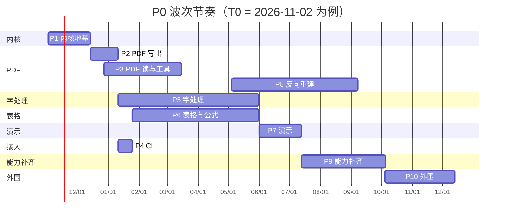
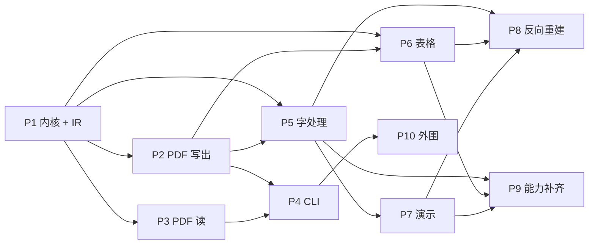

# DocCore — 实施优先级与波次计划

| 项 | 内容 |
|----|------|
| 文档编号 | DOCCORE-PLAN-001 |
| 版本 | 1.6 |
| 状态 | 待评审 |
| 关联 | [01-产品需求书.md](01-产品需求书.md)、[02-详细技术设计书.md](02-详细技术设计书.md) |
| 排序结论 | PDF 写 → PDF 读 → 字处理 → 表格 → 演示 → PDF 反向重建 → 能力补齐 → 外围 |

## 1. 排序结论（一页看完）

| 序号 | 波次 | 内容 | 关键需求 | 前置 | 人月 | 周 | 交付版本 |
|------|------|------|----------|------|------|----|----------|
| P1 | 内核地基 | IO 与限额、ZIP/OPC、XML、字体、图像、Layout IR、PNG 光栅 | F-001 F-002 F-004 F-010 F-011 F-012 | — | 12.5 | 6 | 0.1 |
| P2 | PDF 写出 | IR → PDF，字体子集、ToUnicode、PDF/A-2b | F-301 | P1 | 3.0 | 4 | 0.2 |
| P3 | PDF 读与页面工具 | 对象图、内容流、文本抽取、拆合、转图、大纲 | F-302 F-303（读） | P1 | 5.5 | 11 | 0.3 |
| P4 | CLI | `detect` `convert` `extract-text` `split-pdf` | F-901 F-902 | P2 P3 | 1.0 | 2 | 0.3 |
| P5 | 字处理 | DOCX 读写、样式、表格、节、分页排版、导出 | F-101～F-107 | P1 P2 | 22.5 | 20 | 0.5 |
| P6 | 表格与公式 | 稀疏模型、数字格式、公式引擎、打印分页、导出 | F-201～F-204 | P1 P2 | 17.0 | 18 | 0.7 | ✅ 已落地 |
| P7 | 演示 | PPTX 读写、形状树、导出 PDF/PNG | F-401 F-402 | P5 | 4.5 | 6 | 0.9 | ✅ 已落地 |
| P8 | PDF 反向重建 | 几何对象、分块分栏、表格检测、DOCX/XLSX/PPTX 重建 | F-310 F-311 F-312 | P5 P6 P7 | 13.5 | 18 | 1.0 | ✅ 已落地 |
| P9 | 能力补齐 | 图表与条件格式、邮件、条码、旧格式读取、文档比较、透视表、OCR | F-205 F-501 F-601 F-111 F-112 F-206 F-701 | P6 P7 | 25.0 | 12 | 1.1 |
| P10 | 外围 | C ABI、HTTP、许可、域与邮件合并、批注修订、水印 | F-903～F-905 F-108～F-110 | P4 | 8.0 | 10 | 1.2 |

P1–P8 约 79.5 人月，P9 约 25 人月，P10 约 8 人月。按 8 人并行，1.0（P1–P8）约 T0+11，留 10–15% 缓冲落在 T0+12～13；P9 与 P10 依次排在 1.x。

**一句话理由：** PDF 是三个办公族共同的出口，先做它，后面每加一族都立刻能出 PDF；PDF 读不依赖排版引擎，可以独立交付并先产生收入；反向重建必须等三个写出器稳定，因为自产 PDF 是它唯一的验收基准。

## 2. 排序依据

1. **出口先行。** Layout IR 与 PDF 写出同时被字处理、表格、演示消费。先冻结 IR 再写 PDF，三个族后续都只是"往 IR 里塞东西"；反过来先做 Word，IR 会被 Word 的排版细节绑架，改一次三处返工。
2. **不依赖别人的先做。** PDF 读（ToUnicode、内容流、xref）与公式引擎都不依赖排版引擎，可以独立开发和独立验收，适合放在等待期内填满人力。
3. **每波都要能单独发布。** P2 结束就能出 PDF，P3 结束就能卖"PDF 工具箱"，不必等 Word。这是唯一能让项目在 12 个月内持续有可演示产物的排法。
4. **最难的放在有基准之后。** PDF→Office 的验收标准是"转回来像不像"，只有自家三个写出器稳定了，才有一批可重复的基准 PDF。提前做重建等于在流沙上盖楼。

## 3. 逐波次说明

### P1 内核地基（W0，6 周，全员）

**目标：** 一个能链接、能整形中文、能画一页并出 PNG 的空壳库。

**包含：** 错误与警告（含 3.1.1 的码表）、`Stream` 与限额、ZIP/OPC（含 ZIP64 与路径防御）、XML 拉取解析、字体服务（枚举、整形、回退、度量；双向文本先做拉丁与中文，阿拉伯文放 P9）、图像解码（PNG/JPEG/BMP 先行，GIF/TIFF/EMF/WMF 放 P5 前）、Layout IR 定稿、PNG 光栅。

**完成定义：**

- 恶意样本集（压缩炸弹、`../` 条目、外部实体、超大文本节点）全部被拒绝，进程不崩。
- 字体服务能把"你好"整形成字形序列，缺字时回退并产生 `FontSubstituted`。
- 手工构造一份 IR，能输出 PNG 且像素与预期一致。

**风险：** IR 是这个项目最重要的接口，一旦冻结就很难改。建议在 W0 第 2 周就定稿并冻结，后续只允许"加字段"，不允许"改语义"。

### P2 PDF 写出（W1，4 周）

**目标：** 任何 IR 都能变成合规、可搜索、中文不缺字的 PDF。

**子序：** ① 对象模型与 xref 流 ② 内容流与文本矩阵 ③ 字体子集与 ToUnicode（连字映射） ④ 图像（DCT 直通、Flate、软掩码） ⑤ PDF/A-2b 与验证器接入。

**完成定义：** 自产 PDF 抽回的 Unicode 与 IR 完全一致；换一台无该字体的机器仍能显示中文；PDF/A-2b 通过验证器。

**风险：** 子集化与 ToUnicode 是"看起来简单、错了很难查"的部分，必须先用 1000 个常用汉字 + 拉丁 + 标点做回归。

### P3 PDF 读与页面工具（W2，11 周，与 P2 部分并行）

**目标：** 能读第三方 PDF，并交付第一个可卖的产品——PDF 工具箱。

**子序：** ① xref 表/流、增量更新、页树 ② 内容流算子集（按 3.5.2 的完整清单） ③ 字体与编码、ToUnicode 抽取 ④ 阅读顺序与多栏 ⑤ 拆合与转图 ⑥ 大纲读取、加密打开（R2–R5）。

**完成定义：** 自产 5 页 PDF 抽取 100%；第三方文本型 PDF 阅读顺序 ≥95%；加密未知密码返回 `NeedPassword` 且不导出页面图像。

**可发布能力（0.3）：** 批量抽文本、拆分、合并、转图、读大纲。这一版不依赖任何办公文档能力，是最早能拿到客户反馈的版本。

**风险：** 第三方 PDF 的长尾极长（内联图、Form XObject、Type3 字体、损坏 xref）。策略是"跳过并警告"优于"整页失败"，模糊测试进 CI。

### P4 CLI（W3，2 周，1 人）

**目标：** 让 QA 和客户不写 C++ 也能跑通。

**完成定义：** `detect` / `convert` / `extract-text` / `split-pdf` 可用；退出码按 PRD 6.2 映射；`--json` 的 stdout 只有 JSON。

**为什么这么早：** 后续每一波的回归都靠 CLI 脚本驱动，晚做等于让测试手工点。

### P5 字处理（W4，20 周，3 人）

**目标：** DOCX 进、DOCX/PDF/HTML/TXT 出，中文公文分页可交付。

**子序（严格按此顺序，不要并行）：**

1. DOM 与 OOXML 读（含未识别部件保留、`w:sectPr`、页眉页脚关系）
2. 样式级联与编号（`basedOn` 环检测、多级列表）
3. 表格（合并、嵌套、行跨页）
4. 节与页面设置（纸张、分栏、页码起始）
5. 排版引擎：换行 → 分页 → 浮动图 → 表格拆分 → 脚注区
6. 导出 PDF / HTML / TXT，以及 DOCX 写回

**完成定义：** P0 黄金集结构保真 ≥95%；中文 A4 公文页数与文本层一致；同一文档连续排版两次分页一致。

**可发布能力（0.5）：** Word 转 PDF，这是本项目第一个"能卖钱"的核心能力。

**风险：** 排版引擎是全项目最大的单点（约 8 人月）。若 T0+5 个月时黄金集通过率仍低于 80%，按第 7 节砍单顺序处理，不要靠加人硬顶——排版是收敛型任务，加人只会增加沟通成本。

### P6 表格与公式（W5，18 周，2 人，与 P5 并行）

**目标：** XLSX 进、XLSX/PDF/CSV/HTML 出，公式算得对。

**子序：**

1. 稀疏模型、共享字符串、样式与数字格式（含千分位与货币）
2. 公式解析（递归下降、AST、运算符优先级）
3. 依赖图与重算（拓扑、循环检测、易变函数同一时间戳）
4. P0 函数集：先 `SUM/AVERAGE/COUNT/MIN/MAX/IF/AND/OR/NOT/ROUND/ABS`，再文本函数，最后 `VLOOKUP/INDEX/MATCH/SUMIF/COUNTIF`
5. 打印分页（重复标题行、打印区域、适应页宽）
6. 导出 PDF / CSV / HTML

**完成定义：** 50 万单元格打开 <5 s；P0 函数黄金集与基准一致（数值 1e-9）；循环引用只影响环上单元格。

**可发布能力（0.7）：** 报表转 PDF、批量导出 CSV。

**风险：** 函数语义的坑集中在"参数类型转换"（文本数字、空单元格、错误值传播）。P0 只承诺 F-202 列出的函数，其余返回 `#NIMPL!`，不要顺手多做。

### P7 演示（W6，6 周，字处理组收尾）

**目标：** PPTX 进、PPTX/PDF/PNG 出。

**为什么放这里：** 它是四族里最便宜的——绝对定位、无分页、复用 P5 的文本整形与 P2 的 PDF 写出，只差一个形状树 DOM。

**完成定义：** 3 页幻灯片导出 3 页 PDF 且文本可抽取；页面尺寸与 PDF 页一致；图片位置偏差 ≤2 pt。

**完成情况（1.4）：** 三条全部达成并被 `tests/verify_pptx.py` 逐条断言——3 页 → 3 页、`MediaBox` 960×540 pt 与 `sldSz` 一致、每页文本经 ToUnicode 反查后逐段比对、图片 `cm` 矩阵与形状矩形四边偏差均 ≤2 pt（实测 0 pt）。往返（读→写→读）后页数、尺寸、形状矩形、表格单元格文本、备注全部保持不变。

**可发布能力（0.9）：** 四族导出齐活，此时可以对标"任意办公文档转 PDF"。

### P8 PDF 反向重建（W7，18 周，2→3 人）

**目标：** PDF 变回可编辑的 DOCX / XLSX / PPTX。

**子序：**

1. 几何对象抽取（文本行、线段、图像，复用 P3）
2. 分块、分栏、阅读顺序
3. 表格检测（框线优先，无框线走对齐启发式）
4. DOCX 重建（先做，因为最容易验证）
5. XLSX 重建（合并单元格与数值识别）
6. PPTX 重建（绝对定位文本框）

**完成定义：** 按 PRD 分级门禁——① PDF 读取达标 ② PDF→DOCX 达标 ③ XLSX/PPTX 达标。①② 必须完成，③ 未达标则 1.0 只承诺已达标方向。

**风险：** 这是全项目最不确定的一块，也是"客户以为能无损还原"最容易吵架的地方。发布说明里必须写清 `Lossy`，并且扫描件一律返回 `NoTextLayer`。

**完成情况（1.5）：** 分级门禁三条全部达标——① PDF 读取：经典 xref 表、xref 流、`/Prev` 链、`/XRefStm`、全文件兜底扫描五种路径都能打开文件，过滤器覆盖 Flate+PNG 预测子、ASCIIHex、ASCII85、RunLength，`/ToUnicode` 与预定义 Unicode CMap（`UniGB-UCS2-H`/`UniGB-UTF16-H`，无 ToUnicode 时按码点输出）双路解码，内容流算子含 `q Q cm BT ET Tf TL Tc Tw Tz Ts Tm Td TD T* Tj TJ ' "` 与 `g rg k G RG K w m l c v y h re f F f* S s n Do`。② PDF→DOCX/F-310：`tests/verify_pdf.py` 用 PyMuPDF + python-docx 独立校验，正文 39/39 行完整（100%，门槛 95%），框线表仍是 Word 表格（格子文字逐格对上），标题映射到 Heading 1，图片以 PNG 嵌入 `word/media`。③ XLSX/PPTX 同样达标：XLSX 3 张工作表，数字写成数值、双栏按阅读顺序排列；PPTX 3 张幻灯片、页面尺寸等于 PDF 页、表格与图片落位偏差 0 pt。扫描件（只有整页图）在三个方向都返回 `Unsupported` + `NoTextLayer` 告警，不产出半成品。

### P9 能力补齐（W8，12 周）

**目标：** 把"能转"补成"转得像"，并覆盖二阶段格式。

**子序：**

1. 图表与条件格式（F-205）——直接决定 XLSX→PDF 的观感，客户投诉率最高，必须第一个做
2. 邮件与条码（F-501、F-601）——EML/MSG 读写与二维码生成，可嵌入 Word/PDF
3. 旧格式读取（F-111）——DOC/RTF/ODT 接同一个 text DOM，转 PDF 复用 P5 的排版路径
4. 文档比较（F-112）——在 text DOM 上做序列对齐，产出修订
5. 透视表（F-206）
6. OCR 插件（F-701）

**完成定义：** 含图表的 XLSX 导出 PDF 柱高与数据成比例（150 DPI 下 1 像素容差）；含两个附件的 EML 能取出主题、正文与附件；DOC 转 PDF 正文完整率 ≥98%。

**完成情况（子序 1，图表部分 F-205）：** 图表链路已打通两段。
① **读取与回写**（P9-1a）：`xlsx_read` 按 `sheet → drawing → chart` 的关系链解析出 `Chart DOM`（类型、系列、分类、锚点），并把 drawing/chart 部件连同各自的 `.rels` 一并保留；`xlsx_write` 原样回写这些部件，XLSX→保存→重开后 openpyxl 仍能看到全部 3 张图。**关键教训**：图表能往返的前提是**关系（rels）也要保留**，只留部件字节会让 openpyxl 侧读成 0 张图。
② **渲染进 Layout IR**（P9-1b）：柱/条/折线/面积/散点/饼/环形全部落到 `DrawPath`/`DrawText`，按"好看的刻度"（1/2/2.5/5×10ⁿ）定标纵轴；分页时把图表矩形折进列范围，且图只画在与它相交的那一条分页带上。单测 `TestChartLayout` 断言簇状柱高 ∝ 值、堆叠段从基线累加、饼图扇区张角 ∝ 值。
③ **独立像素验收**：`tests/verify_chart_pdf.py` 用 openpyxl 造数据、DocCore 导 PDF、PyMuPDF 按 150 DPI 光栅化，再**不依赖 DocCore 代码**地从像素反推——柱图取每列最长连续墨迹当高度、饼图在盘内圆环上量扇区张角。簇状柱、堆叠柱、饼图三类在 10 组随机数据下全部 `ok`，柱高残差 ≤1 px。测量过程中的两个坑：调色板里 teal 投影到 blue 的 α≈0.9 会串色，饼图改用"颜色欧氏距离"（目标色距离 0、最近异色 44）才隔离干净；表格中灰网格线 α≈0.34，需靠"最长连续段"而非总面积来隔离柱。
④ **修掉一个真实渲染 bug**：堆叠柱原先把 `stack_top` 跨分类累加（应按分类竖向累加），且纵轴按单值而非"每类合计"定标，导致第 2 根柱叠到第 1 根顶、整根飞出绘图区。独立验证器截图暴露后已修，并补了 `TestChartLayout` 的堆叠回归断言。

**完成情况（子序 1，条件格式部分 F-205）：** 条件格式链路已打通四段。
① **DOM 建模**：`sheet.h` 新增 `CfType{CellIs,Expression,Unknown}`、`CfOperator`（8 个 OOXML 运算符）、`CfDxf{fill,font_color,bold}`、`ConditionalRule{type,op,operands,formula,dxf,dxf_id,priority}`、`ConditionalFormat{range,rules}`；`Workbook` 持有 `dxfs` 表，`Worksheet` 持有 `conditional_` 列表。
② **求值器**：`sheet.cpp` 实现 `CfEvalContext`（把公式里的相对引用解析到当前格）、`ShiftAst`（按区域左上角把相对 Ref/RangeRef 平移，因为 OOXML 公式相对区域首格书写）、`CompareOperands`（cellIs 数值比较）、`RuleMatches`（cellIs 仅数值比较；expression 走 `ParseFormula`+`ShiftAst`+`Evaluate`，真值取布尔真或数值≠0）、`MatchedConditionalDxf`（遍历格式，命中且 priority 最小者胜）。`RuleMatches` 的 cellIs 分支已纠正为纯数值比较（原先误写文本比较分支）。
③ **渲染叠加**：`sheet_layout.cpp` 在 `DrawPage` 填底色前先查 `MatchedConditionalDxf`，命中则用 `cf->fill` 覆盖底色、`cf->bold` 叠加粗体、`cf->font_color` 覆盖字色，所以导 PDF 时条件高的格会带差异格式颜色。
④ **XLSX 往返**：`xlsx_read` 读 `<dxfs>`（dxf 的填充色在 `<bgColor>` 而非 `<fgColor>`，做了 `<fgColor>` 兜底）与 `<conditionalFormatting sqref>`（每个 `cfRule` 取 `type/operator/priority/dxfId/formula`，cellIs 的 formula 解析为 `std::stod` 操作数，expression 原样存为 `rule.formula`）；`xlsx_write` 写回 `<dxfs>` 与 `<conditionalFormatting>`，`FindDxf` 按 fill/font_color/bold 去重以保证 `dxfId` 稳定。夹具 `tests/data/sample_cf.xlsx`（`B2:B6` 上 `greaterThan 100` 红色填充）与单测 `TestConditionalFormat` 断言：1 条规则、范围 `B2:B6`、值 `{150,80,200,95,120}` 命中 `{真,假,真,假,真}`、Layout IR 中恰好 3 个红格、回写后 CF 不丢。

**完成情况（子序 1，数据验证部分 F-205）：** 列表型数据验证的写入契约已按验收标准落地。DOM 新增 `ValidationType{List,Whole,Decimal,Date,TextLength,Custom}`、`ValidationOp`（8 个）、`DataValidation{type,op,formula1/2,allow_blank,show_error,error_style,ranges}`、`ValidationResult{written,rejected,warned}`；`Worksheet` 持 `validations_`，`Workbook` 持 `strict_validation` 与 `write_warnings_`。核心是带验证的写入口 `Worksheet::WriteCell(row,col,Value)`：命中列表型验证且值不在列表中时——**默认模式仍写入并向 `write_warnings_` 追加 `ValidationFailed(1018)` 警告**（warned），**严格模式拒绝写入、值不变并返回 rejected**。合法取值由 `ListValues` 解析：formula1 是引号包裹的内联列表（如 `"Yes,No,Maybe"`）直接拆逗号，是区域引用（如 `Sheet1!$A$1:$A$3` 或 `$G$2:$G$4`）则在 Workbook 上取区域内每个非空格的文本；比对按 Excel 口径大小写不敏感。`ValidationAt` 返回首个覆盖该格的验证。读写两侧：`xlsx_read` 解析 `<dataValidations>`（sqref 可多段、type/operator/allowBlank/showErrorMessage/errorStyle/error*/prompt*、formula1/2），`xlsx_write` 在 `<conditionalFormatting>` 之后回写 `<dataValidations>`（sqref 由各段拼回）。夹具 `tests/data/sample_dv.xlsx`（内联列表 `B2:B6` + 区域引用列表 `D2:D6` 引用 `G2:G4`）由 `tests/make_sample_dv.py` 生成；单测 `TestDataValidation` 覆盖读入两条验证、`ListValues` 两种来源、`WriteCell` 合法/软失败告警/严格拒绝/未命中、以及往返保留。openpyxl 独立复核往返产物仍是合法 list 验证，`verify_xlsx.py` 通过。`doccore_tests` 现 **1409 项，0 失败**。

**完成情况（子序 2，邮件部分 F-501）：** EML 与 MSG 两条读取链路都已打通。
① **EML/MIME**：`mail.cpp` 按 boundary 递归拆 multipart（深度上限 32），传输编码覆盖 base64 与 quoted-printable，头部按 RFC 5322 做折行合并；RFC 2047 编码词（`=?charset?B/Q?text?=`）解码，字符集覆盖 UTF-8/Windows-1252/Latin-1/UTF-16。`text/plain` 与 `text/html` 都进 `MailMessage`，`body_kind` 首选 HTML；带 `Content-Disposition: attachment` 或 `filename` 的分部一律走附件，不再与正文混淆。附件扩展名与实际内容不符时按魔数探测真实 MIME（PNG/JPEG/GIF/PDF/ZIP/OLE/GZIP/RTF/BMP）。
② **MSG/CFB**：`msg.cpp` 手写 OLE2 复合文档读取（512 字节头、DIFAT→FAT→Directory→MiniFAT→mini stream，小于 4096 的流转到 mini stream），按 `__substg1.0_<PPPP><TTTT>` 命名取属性流：主题 0x0037、代码页 0x3FFD、发件人姓名 0x0C1A、发件人邮箱 0x0065、正文 0x1000；PT_UNICODE(0x001F) 按 UTF-16LE 解，PT_STRING8(0x001E) 按属性里的代码页转 Unicode。
③ **踩过的两个真 bug**：`const std::string& body = h.body;` 之后 `const std::string_view part = body.substr(...)` ——`substr` 返回临时 `std::string`，绑到 `string_view` 后立刻悬空，小分部侥幸存活、较大的 alternative 分部读到已复用堆内存被解析成垃圾 text/plain；改为 `const std::string_view body = h.body;` 让 `substr` 返回指向活对象的视图。另一个是 `text/plain` 附件被误路由进正文，补了 `is_attachment` 判定。
④ 夹具 `tests/data/sample.eml`（multipart/mixed→alternative + 2 个附件，其中一个扩展名 `.bin` 实为 PNG）与 `tests/data/sample.msg`（手写 OLE2，主题用 Windows-1252 的 0xE9/0x93/0x94），MSG 夹具用 olefile 独立复核过分区表与 mini stream。单测 `TestMail` 覆盖主题 RFC 2047 解码、收发件人、正文双格式、两个附件及其 MIME 探测、MSG 非 Unicode 代码页主题，以及 base64/QP/字符集三个复用解码器。

**完成情况（子序 2，条码部分 F-601）：** QR 与 Code128 两个编码器已按验收标准落地并做了三重独立校验。
① **QR（ISO/IEC 18004，字节模式）**：版本 1–40、EC 等级 L/M/Q/H。完整内置三张规格表——`kEc[40][4]`（每块 EC 码字数 + 两组块数/数据码字数）、`kTotalCw[40]`（总码字数）、`kAlign[40][7]`（对齐图案中心）；GF(256)（本原多项式 0x11D）上做 Reed-Solomon，按组交错数据码字与 EC 码字。矩阵构造含三个定位图案+分隔符、定时图案、对齐图案（跳过与定位图案重叠的三个角）、版本信息（v≥7 的 BCH(18,6)）、固定深色模块；数据按蛇形两列一组写入；8 个掩膜按 ISO 表 11 四条惩罚规则选最小分；格式信息为 BCH(15,5) ^ 0x5412。
② **Code128（ISO/IEC 15417）**：Code set B（ASCII 32..126），107 个符号宽度表 + Start B + 加权校验位 + 停止码（`233111` 后接 2 模块终止条）。越界字符返回 `InvalidArgument`。QR 超出所选等级与版本 40 容量时抛 `Error(LimitExceeded)`，不输出残缺符号。
③ **踩到的一个真 bug**：格式信息位的行列写反了——参考实现用 `setFunctionModule(x, y, ...)`（x=列、y=行），照搬时没换成自己的 `SetF(row, col, ...)` 约定，导致 15 位格式信息整体转置、固定深色模块落错位置。三个定位图案因为图案本身转置对称、定时图案因为是行列双写，都侥幸没暴露，是单测的"固定深色模块"断言第一个抓到。
④ **三重独立校验**：规格表三张全部与 python-qrcode 的权威数据逐项比对（160 个版本/等级组合 0 差异，且 `块数×(数据+EC) == 总码字数` 全部自洽）；70 张 QR 图（4 个等级 × 17 个长度边界 + 各等级版本 40 极限，含 v1/v2/v7/v10/v40 边界与 UTF-8 多字节载荷）全部被 zxing-cpp 读回同一载荷（70/70），cv2 读回 69/70（唯一未读回的 v9 码，python-qrcode 用同一掩膜生成的图 cv2 也读不出，属 cv2 自身局限）；掩膜选择用独立实现的四条惩罚规则复核，70/70 都是惩罚最小掩膜（该实现的计分函数又与 python-qrcode 的 `lost_point` 逐格一致）。版本最小性按权威分块表独立重算，70/70 一致。Code128 由 zxing-cpp 读回 `"AB"`。单测 `TestBarcode` 断言版本 1 各等级容量边界（L=19/M=16/Q=13/H=9 数据码字）、跨版本边界、定位图案/分隔符/定时图案/固定深色模块/对齐图案结构不变量、超容量抛错、Code128 宽度串与校验位，并把全部产物写到 `out/` 供 Python 校验器消费（`tests/verify_barcode.py`、`tests/verify_qr_mask.py`）。`doccore_tests` 现 **5371 项，0 失败**。

**为什么排在 P10 之前：** 这一波每一项都是客户能直接看见的差异（图表、邮件、旧文档），而 P10 的 C ABI/HTTP 只是集成方式，不影响"转出来好不好看"。先补观感，再补接入面。

### P10 外围（10 周）

**子序：** C ABI（含 `doccore_convert*`）→ HTTP → 许可 → 域与邮件合并 → 批注修订与内容控件 → 水印。顺序按"被集成方问到的频率"排，不按技术难度排。

**发布门禁提示：** 许可（F-905）落在这一波，但它不是可选外围。若 1.0 要商用发行，必须把许可拆出来从 W6 起并行；否则 1.0 只能按技术预览发布，未许可水印与到期行为也无从约束。C ABI 同理——它是 Python/C#/Java/Rust 绑定的唯一入口，首批客户若用非 C++ 语言集成，也必须前置。

### P11 四族深度对齐（插单，PDF / Word / Excel / PPT）

**触发：** P9 执行到子序 3（旧格式）时调整优先级——只做 PDF、Word、Excel、PPT 四族，但深度必须对齐 Aspose；旧格式（F-111）、文档比较（F-112）、OCR（F-701）先放放。

**判据：** 每一项都以"Aspose 有、我们没有"为缺口，且必须能被第三方实现独立复核（PyMuPDF / openpyxl / python-pptx 读回，不共享 DocCore 代码）。

**子序：**

1. PDF 链接与书签（F-303 深度）——链接注释、命名目标、大纲树
2. PDF 注释（F-304 深度）——Text/Highlight/Square/Circle/Underline/FreeText/Stamp 读写
3. PDF 加密（F-303 深度）——标准安全处理器 RC4-40 / RC4-128 / AES-128 / AES-256
4. Word 水印与文档保护（F-110 深度）——文字/图片水印、`w:documentProtection`、`w:writeProtection`
5. Excel 透视表（F-206 深度）——`pivotTableDefinition` 读写与刷新
6. PPT 动画与切换（F-403 深度）——`p:transition` / `p:timing` 往返

**完成情况（子序 1）：** 已打通。

① **IR 落地**：`LayoutPage` 增加 `links`/`dests`，`LayoutDocument` 增加 `bookmarks`；`Link` 区分外部 `uri` 与内部 `dest`，`NamedDest` 承载 `w:bookmarkStart` 之类的落点，`Bookmark` 用 `level` 表达层级。这三块在此之前是**空字段**——没有任何代码往里写，PDF 写出也不读。

② **三条产出链各自接上**：
- Word：`text_layout` 的 `InlinePiece`/`Atom` 带 `link_uri`/`link_dest`/`bookmark`，`BuildPieces` 把 `Text` 的 `hyperlink_target`/`hyperlink_anchor` 和 `BookmarkStart` 传下去，`EmitLine` 按 run 的横向区间产出 `Link`、为零宽书签原子产出 `NamedDest`；大纲优先取 `w:outlineLvl`，缺失时按样式名（`heading N`/`标题 N`）推断，因此**内置标题样式没写 outlineLvl 也能出大纲**。
- Excel：`Worksheet` 新增 `Hyperlink`（`range`/`target`/`location`/`display`/`tooltip`），`xlsx_read` 解析 `<hyperlinks>` 并靠工作表 `_rels` 的 External 关系把 `r:id` 还原成 URL，`xlsx_write` 写回 `<hyperlinks>` 与 `_rels`（外部超链接与绘图部件的 `r:id` 统一分配，顺序必须与工作表 XML 一致）。打印布局三遍走：收集被引用的单元格 → 排版时记录落点 → 补命名目标。
- PPT：`Line` 增加行内 `LinkSeg`（相对行首的宽度区间），`WrapParagraph` 在三种追加位置（正常、超宽硬断、折行后）都打标记，`EmitTextBody` 按区间产出 `Link`；每页幻灯片用标题占位符文本产出一条大纲。

③ **PDF 序列化**：`/Annots` 链接注释、`/Dests` 命名目标、`/Outlines` 大纲树；文本字符串含非 ASCII 时改 UTF-16BE + BOM 十六进制，名字对象按 `#XX` 转义。

④ **两个真实 bug（都是独立验证器抓到的）**：
- **顶层大纲兄弟没有 `/Next`**：建树只在"有父节点"分支里链 `prev`/`next`，顶层节点全部落单，PyMuPDF 只读出第一支（5 条变 3 条）。改成"父下标 + 1"作槽位的 `first_of`/`last_of` 数组后，顶层与子层共用同一套链接逻辑。
- **`/Dests` 只写名字树会被误解析**：PyMuPDF 的 `resolve_names()` 先走 PDF 1.1 分支，只要 `/Dests` 是字典就按"名字 → 目标"逐项解析，于是把名字树的 `/Names` 键当成目标值，抛 `could not convert string to float`。改为**两种形式同时写**（1.1 字典 + `/Names /Dests` 名字树），链接动作改用名字对象 `/D /name`。

⑤ **独立验收**：`tests/verify_pdf_links.py` 用 PyMuPDF 复核 4 个产物、**46 项断言全绿**——链接种类与数量、URI 原文（含中文）、GoTo 目标页、矩形在页内且非退化、命名目标的页与坐标、大纲的标题/层级/页码/跳转点。`doccore_tests` **5448 项断言全绿**。

**完成情况（子序 2）：** 已打通。

① **读**：`PdfPage::annotations()` 惰性解析 `/Annots`，覆盖 26 个子类型（Text/Link/FreeText/Line/Square/Circle/Polygon/PolyLine/Highlight/Underline/Squiggly/StrikeOut/Stamp/Caret/Ink/Popup/FileAttachment/Sound/Movie/Widget/Screen/PrinterMark/TrapNet/Watermark/3D/Redact），字段含矩形、颜色、不透明度、作者、正文、主题、修改时间、唯一名、图标名、QuadPoints、外观流存在性；认不出的子类型保留原文名。

② **写**：`AddAnnotations()` 走**增量更新**（PDF 32000-1 §7.5.6）——原文件字节逐字节保留、追加新对象、用同一对象号给受影响页面字典写新版本、末尾写带 `/Prev` 的 xref 段。不做整体重写，是因为重写会重新序列化每个对象，字体子集/图像流/加密字典都可能被无意改变。

③ **外观流是必需的**：每条注释生成自己的 `/AP /N`（Form XObject，`/BBox` 与 `/Rect` 同尺寸所以映射是纯平移）。不生成的话 Highlight/Square 在多数阅读器里是空白。Circle 用四段贝塞尔（k = 4/3·(√2−1)）；Highlight 用 `/ExtGState << /BM /Multiply /ca 0.55 >>` 做正片叠底半透明，这才是荧光笔的观感；FreeText 与 Stamp 用标准 14 字体里的 Helvetica，不需要嵌入。

④ **一个真 bug**：非 ASCII 文本（中文作者、中文正文）原先按原始 UTF-8 字节写成十六进制字符串，读回来会被按 PDFDocEncoding 解释成乱码。改为 UTF-16BE + BOM 后再转十六进制（§7.9.2.2），中文才双向一致。

⑤ **独立验收**：`tests/verify_pdf_annotations.py` 用 PyMuPDF 复核 **34 项断言全绿**——关键一项是 `doc.is_repaired == False`：增量更新的 xref 段写错时，自己的读路径往往看不出来（自己写自己读是对称的），但 MuPDF 会直接判定文件损坏、靠扫描救回来。此外还核对 6 条注释的类型/页码/矩形（含 y 轴翻转）/颜色/不透明度/作者/正文/图标名，以及**把注释区域光栅化数像素**确认外观流真的画出了东西（黄色描边、黄色半透明叠底），最后验证二次追加不会冲掉既有注释。`doccore_tests` **5501 项断言全绿**。

**完成情况（子序 3）：** 已打通。

① **密码学原语自实现**：`src/kernel/crypto.cpp` 提供 MD5、SHA-256/384/512、RC4、AES-128/192/256、CBC、PKCS#7，只用 RFC/FIPS/NIST 标准向量校验（MD5 覆盖 55/56 字节填充边界、RC4 用 RFC 6229、AES 三档密钥用 FIPS 197、CBC 用 SP 800-38A、非法填充必须被拒）。不链接 OpenSSL——"零依赖"这条约束在加密路径上同样成立。

② **标准安全处理器**：`src/pdf/pdf_crypt.cpp` 覆盖 `/V1 R2`（RC4-40）、`/V2 R3`（RC4-128）、`/V4 R4`（按 `/CF` 的 `/CFM` 选 RC4 或 AES-128）、`/V5 R5/R6`（AES-256，`R6` 走 Algorithm 2.B 迭代哈希）。算法 1（每对象密钥，AES 追加 `sAlT`）、2（文件密钥，`/P` 必须小端有符号）、3.A（算 `/U`，`R2` 比 32 字节、`R3+` 只比前 16 字节）、6（所有者口令回退）全部按 32000-1 落地。

③ **解密接进读路径**：放在 `ResolveRef` 里，对象取出即解、`cache` 存明文，上层（正文抽取、字体、图像、重建器）完全不需要知道加密存在。`/Encrypt` 自身对象号排除、`/Type /XRef` 永不解密、`/EncryptMetadata false` 时 `/Type /Metadata` 流不解密。空口令先试一次（很多文件只设了所有者口令），失败才抛 `NeedPassword`，并按"没给口令"与"口令错"给出不同消息。

④ **一个真 bug**：所有者口令路径漏了 Algorithm 3 步骤 (a) 的**口令填充**——直接拿原始口令进 MD5。症状极具误导性：用户口令全绿，只有所有者口令失败，而 AES-256（`R6` 不经过这条路径）也是全绿。修掉后四档的两种口令全部通过。

⑤ **顺带补齐权限位**：`/P` 的 1 基位号 3..12 折成 `PdfPermissions`（打印、改内容、复制、注释、填表、无障碍提取、装订、高质量打印），未加密文档返回全 true，符合阅读器惯例——Aspose 的 `Document.Permissions` 就是这个位置。

⑥ **独立验收**：`tests/verify_pdf_decryption.py` 用 PyMuPDF 复核 **109 项断言全绿**，分三层：先确认每个夹具**真的是它声称的算法**（从原始字节读 `/V` `/R` `/CFM`，否则"解密成功"可能只是因为文件根本没加密）；再确认正文在原始字节里**找不到明文**；最后把 DocCore 落盘的正文与 PyMuPDF 解出的正文**去空白后逐字比对**。夹具由 PyMuPDF 加密、DocCore 只负责解密，两套实现独立——自己加密自己解密是对称的，两边的同类错误会互相抵消，测不出任何东西。`doccore_tests` **5630 项断言全绿**。

**完成情况（子序 4）：** 已打通。

① **水印不是元素，是页眉里的 VML 形状**：`w:pict` → `v:shape` → `v:textpath`（文字）/ `v:imagedata`（图片）。读侧只在页眉里找，且**只认明确带水印标记的形状**（`id` 含 `watermark` 或带 `Watermark` 属性）——页眉里还可能有普通图片和艺术字，误吞会把正常内容吃掉。认出之后把承载段落从页眉排版流里摘掉，否则会被当成普通页眉图片再排一次。

② **字号是盒子拉伸出来的**：Word 写 `font-size:1pt` + `fitshape="t"`，真实字号 = "把文字拉伸到形状盒宽度"所需的字号。排版时先在 1pt 下量一次宽度，再按 `盒宽 / 单位宽` 反推。盒宽缺省取页宽的 0.8868 倍（Word 在 A4 上就是 527.85pt），高宽比 5:1。

③ **IR 增加文字旋转**：`DrawText::rotate_deg`（绕基线起点、逆时针为正）。IR 是 y 向下，视觉逆时针 θ 对应 `x' = x·cosθ + y·sinθ`、`y' = -x·sinθ + y·cosθ`；PDF 的 `Tm` 用 `[cosφ sinφ -sinφ cosφ]`，两边视觉一致。Word 的 `rotation` 顺时针为正，所以 `φ = -rotation`。水印排在每页 `ops` 最前面（最先画 = 最底层）。

④ **写侧整段 VML 按原文拼**：VML 的前缀混用（`v:shape` 的 `style` 不带前缀、`o:spid` 带前缀），交给自动加前缀的 XML 构造器只会写错——第一版就是把 `<v:shape>` 写成了 `<w:shape>`，被独立校验器抓到。两块 `shapetype` 样板照抄 Word 的输出，不自创形状。没有页眉的节要合成一个只含水印的默认页眉，并补 `headerReference`；图片水印还要写媒体部件、页眉 `_rels` 与 `[Content_Types].xml` 的 `Default`。

⑤ **文档保护**：`w:documentProtection` / `w:writeProtection` 只存迭代哈希（ISO 29500 §17.15.1.29），口令不在文件里。`w:cryptAlgorithmSid` 用的是 CryptoAPI 的 ALG_ID 尾号（4=SHA-1、12=SHA-256、13=SHA-384、14=SHA-512），不是 ST_Algo 的序号——写错会让所有 Word 2007 文件校验失败。`settings.xml` 不做整体重写：原文整段存进 DOM，写回时只做补丁式替换（按本地名删旧元素、在根标签后插新元素），其余开关（兼容性、语言、修订参数、缩放）一个字节都不动。

⑥ **顺带补的公共件**：`doccore::Base64Encode/Base64Decode`（内核层，替掉了 `mail` 里那份重复实现）、`crypto::Sha1`（老式文档保护的默认算法）。

⑦ **独立验收**：`tests/verify_docx_watermark.py` **53 项断言全绿**，三路交叉——`zipfile` + `ElementTree` 核对生成的 XML（`v:shape`/`v:textpath`/`rotation:315`/`#C0C0C0`/`opacity`/`fitshape`/命名空间/页眉引用/媒体部件/`_rels`/`Content_Types`），`python-docx` 确认包结构被第三方实现接受，`PyMuPDF` 确认 PDF 里水印**真的是 45° 旋转、银灰、大字号**（读 line 的 `dir` 向量而非 span），并把页面中心光栅化数非白像素确认真的画出来了。文档保护的口令哈希在 Python 里用 `hashlib` **重新实现一遍**与 C++ 逐字节比对——两边独立，实现错了立刻暴露。`doccore_tests` **5714 项断言全绿**。

**完成情况（子序 5）：** 已打通。

① **透视表是三个部件加一条关系链**，不是单个元素：`sheet → pivotTable → pivotCacheDefinition → pivotCacheRecords`。最容易漏的是 **workbook 级**的 `<pivotCaches>`——它挂在 `xl/workbook.xml` 而不是工作表上，少写这一块 Excel 打开后会把透视表当"无源缓存"静默丢掉。它在 `CT_Workbook` 的 sequence 里排在 `definedNames` 之后、`calcPr` 之前，位置写错同样判定损坏。

② **刷新基于实时数据，不是缓存记录**。缓存只是上次刷新的快照，刷新就是把快照换成现在。七步：重读表头 → 逐行读源区域（全空行跳过）→ 每列重建共享项（排序去重，数值在前）→ 枚举行/列组合（按首次出现登记、再按下标元组排序得稳定顺序）→ 逐格累加（Welford 算方差，`Count` 数非空、`CountNumbers` 只数数值，对应 COUNTA/COUNT）→ **先清空再写** → 重建 `rowItems`/`colItems`。

③ **"先清空"必须按实际占用范围清**。第一版按"本次要写的范围"清，源数据变少时上一次的残行还在——而 `rowItems` 已经变短，Excel 会把多出来的行当孤儿。改为 `UsedAround` 求目标区域当前真实占用（上界留 64 行/列余量）后残行才干净。

④ **脏标记决定写回策略**：读入的表默认 `dirty = false`，保存时三个部件在 `unknown_parts` 里**按字节透传**——透视表 XML 里有大量没建模的布局开关（压缩/大纲形态、每字段 subtotal 组合、排序作用域），重新生成必然丢东西。只有 `RefreshPivot` 过或新建的表才重新生成，同时把原部件从透传列表剔掉（`regenerated` 集合），否则会出现两份同名部件。

⑤ **补了一个 API 缺口**：原 `AddPivotTable` 从**目标工作表**读表头，导致"数据表 + 透视表分两张表"这个最常见的布局根本无法建表（建出来字段名全是"字段1/字段2"）。加了带 `source_ws` 的重载，原签名委托过去，行为不变。

⑥ **独立验收**：`tests/verify_xlsx_pivot.py` **113 项断言全绿**，四路交叉——`zipfile` + `ElementTree` 核对三部件结构、**元素 sequence 顺序**、四条关系闭合、`<pivotCaches>` 的 `cacheId`/`r:id` 能否顺着 `workbook.xml.rels` 指回同一个缓存部件；`openpyxl` 的透视表对象模型完整解析（`TableDefinition`/`CacheDefinition`/`Record`）；**纯 Python 从源表独立重算**一遍再按"行标签/列标签"逐格比对成品网格（不看 DocCore 的中间结果）；最后把成品喂回 `doccore xlsx --mode save`（读入 + 透传写回，另一条代码路径）断言三部件**字节级不变**、网格不变。`doccore_tests` **5831 项断言全绿**。

**完成情况（子序 6）：** 已打通。

① **切换与动画深度差得远，所以分两层做**。`p:transition` 是扁平小结构（22 种标准类型 + 速度 + 自动换片 + 音效），完整建模；`p:timing` 是一棵任意深的时序树（每个效果挂一串关键帧行为节点），只把"哪个形状、什么效果、什么时候、多长"提到语义层——正好是 Aspose `Effect` 的粒度——关键帧细节交给原文往返。

② **方向参数不枚举化**。`dir` 的取值按类型分叉（`cover` 八向、`split` 用 `in`/`out`、`wheel` 用辐条数），用一张联合枚举表只会把"这个实现不认识的合法值"变成丢失，所以原样存字符串。

③ **原文优先 + 显式改写才失效**：`timing_xml` 非空就按字节写回，`SetAnimations`/`ClearAnimations` 清掉原文后改由模型生成。与透视表的脏标记是同一套思路。原文重发前还要过一道**前缀检查**——`<p:timing>` 里若出现根元素没声明的前缀（`p14:`/`p15:` 扩展），搬回来会引用未声明命名空间、把文件写坏，宁可放弃保留。

④ **补了 `Shape::id`**。动画的 `p:spTgt/@spid` 指的就是 `p:cNvPr/@id`，没有稳定 id 根本没法表达"给第几个形状加动画"。读侧存 id，写侧先占住显式设过的值、再从 2 起补空位（1 留给 `spTree`）。

⑤ **两个真 bug**：
- **点击组少关一层 `p:childTnLst`**：第一版收组时只写了 `</p:cTn></p:par>`，标签不平衡，读回来直接抛 `unterminated <p:timing>`。
- **原文提取切掉最后一个 `>`**：抠 `<p:timing>` 原始字节时，结束标签的长度算成 `next + 2 + qname.size()`，正好停在 `>` 上而不是它的后一位，于是写回的 XML 变成 `</p:timing</p:sld>`。这个 bug 极难从"自己的读路径"看出来——**第二次读**才炸，第一次写完全正常。

⑥ **一次排查教训**：上面第 5 条的第二个 bug 定位时，库内 `SaveToFile` 与 CLI 的输出不一致，一度怀疑两条路径不同。实际是 `cmake --build` **没有重新链接 `doccore.exe`**（二进制比静态库还旧），CLI 跑的是修复前的代码。此后凡改核心代码都要确认 CLI 的时间戳，必要时先删再构建。

⑦ **独立验收**：`tests/verify_pptx_transition.py` **73 项断言全绿**，四路交叉——`zipfile` + `ElementTree` 做结构体检（`CT_Slide` 子元素顺序、`p:seq` 里 `cTn`/`prevCondLst`/`nextCondLst` 的顺序、`p:cTn/@id` 全页唯一、`p:bldLst` 在 `p:tnLst` 之后、入场先置可见出场先置隐藏）；**纯 Python 按规范自己走一遍时序树**重建效果列表，与 C++ 读路径的结论逐字段比对；`python-pptx` 确认包结构被第三方实现接受且形状 id 没变（动画的 spid 指着它们）；最后 `doccore pptx --mode save` 回环断言 `<p:transition>` 与 `<p:timing>` **逐字节不变**。`doccore_tests` **5913 项断言全绿**。

## 4. 并行泳道与人力

| 泳道 | 人数 | 负责波次 | 说明 |
|------|------|----------|------|
| 内核与字体 | 1（P1 期 2） | P1 | W0 后转为公共支持，谁缺谁找 |
| PDF | 2 | P2 P3 P8 | W7 期加 1 人做 XLSX/PPTX 重建 |
| 字处理 | 3 | P5 P7 | 排版引擎占 2 人，DOM/读写占 1 人 |
| 表格 | 2 | P6 | 公式引擎独占 1 人，模型与导出 1 人 |
| 测试与样本 | 1 | 全程 | 黄金样本集从 W0 就开始攒，不要等到验收 |
| 轮转（不新开泳道） | — | P9 P10 | 图表随表格组、旧格式与比较随字处理组、C ABI 与 HTTP 随 PDF 组 |

## 5. 与现有里程碑的映射

| 原里程碑 | 原计划 | 实际由哪些波次构成 | 建议 |
|----------|--------|--------------------|------|
| M0 内核 | T0+3 | P1（6 周） | 提前到 T0+2，余量留给 P5 |
| M1 可生成 | T0+6，三族齐发 | P2+P3+P4（PDF 工具箱，T0+2.5）、P5（Word→PDF，T0+7）、P6（Excel→PDF，T0+7）、P7（PPT→PDF，T0+9） | **必须拆成 M1a/M1b/M1c/M1d**，三族齐发在 T0+6 做不到 |
| M2 可互转 | T0+12 | P8（T0+11 起，18 周） | 保留 T0+12 作为"PDF 读 + PDF→DOCX"门禁，XLSX/PPTX 重建顺延到 1.1 |
| M3 套件扩展 | T0+18 | P9（图表、条件格式、邮件、条码、旧格式、比较） | 内容从"外围与能力混合"改为纯能力补齐 |
| M4 长尾与外围 | T0+24 起 | P10（C ABI、HTTP、许可、域、批注、水印）+ P9 剩余的透视表与 OCR | 原名"M4 长尾格式"更名 |

这条映射是本文档最需要拍板的地方：PRD 的 M1 在 T0+6 承诺"三族读写 + 三族导出 PDF"，按 P5/P6 的工程量实际落在 T0+7～9。要么把 M1 拆段，要么砍 P5 的表格嵌套与脚注——后者会让公文场景直接不成立，不建议。

## 6. 依赖关系（硬约束）

三条不可违反的约束：

1. **P1 的 IR 未冻结，P2 不开工。** 否则 PDF 编码器会被返工三次。
2. **P5 的导出未通过黄金集，P8 不开工。** 重建的基准 PDF 必须来自自家引擎。
3. **P7 不早于 P5。** 演示导出复用字处理的文本整形与 IR，独立做会重复实现一遍。

## 7. 砍单顺序

进度落后时按此顺序砍，从上往下：

1. PPTX 重建（P8 的第三项）—— 先只做 DOCX/XLSX
2. XLSX 重建（P8 的第二项）—— 1.0 只承诺 PDF→DOCX
3. 透视表与 OCR（P9 的后两项）
4. 文档比较（P9）
5. 邮件与条码（P9）
6. 条件格式与数据验证（P9）
7. HTTP 服务（P10）—— 只留 CLI 与 C ABI
8. 域与邮件合并、批注修订、水印（P10）
9. C ABI（P10）—— 只留 C++ API 与 CLI

**不可砍：** P1 的限额与安全、P2 的字体子集与 ToUnicode、P5 的分页与表格、P6 的重算正确性、P3 的加密与畸形文件处理、P10 的许可。前五项砍掉不是"少个功能"，是"产品不成立"或"上线出事故"；许可则是商用发行的硬门禁，不在砍单列表内——要卖就必须从 P10 提前到 W6 起并行。

## 8. P0 明确不做

图表绘制、条件格式、动态数组与 LAMBDA、PDF 表单与签名、宏执行、旧二进制格式（DOC/XLS）、文档比较、透视表、OCR、XPS/PS、TeX/PUB/OMR。理由与边界见 PRD 1.4 与 TDD 第 1 节。

## 9. 第一周开工清单

1. 建仓库骨架与 CMake 包，`include/doccore/` 与 `src/{kernel,text,sheet,pdf,deck}` 落地。
2. **定稿并冻结 Layout IR 头文件**（`DrawText` / `DrawImage` / `DrawPath` / `LayoutPage` / `Link`）。这是唯一必须第一个冻结的接口。
3. `kernel/io` 的 `Stream`、`LimitStream`、`Truncate`，以及错误码与警告码枚举。
4. 恶意样本集：ZIP 炸弹、`../` 条目、XXE、超大文本节点、循环 `basedOn`。样本先于代码存在。
5. 字体服务最小闭环：枚举系统字体、整形"你好"、缺字回退。
6. 定基准机与性能脚本框架（哪怕先只测空转）。

## 10. 交付节奏

| 版本 | 能力 | 目标客户场景 |
|------|------|--------------|
| 0.1 | 内核可链接，能出 PNG | 内部 |
| 0.2 | 任意 IR 出 PDF | 内部 / 早期集成 |
| 0.3 | PDF 工具箱：抽文本、拆合、转图、大纲 | 归档、检索、票据处理 |
| 0.5 | Word 转 PDF | 合同、公文、报告 |
| 0.7 | Excel 转 PDF / CSV | 报表、对账 |
| 0.9 | PPT 转 PDF | 演示稿归档 |
| 1.0 | PDF 转回 Word（Excel/PPT 按门禁） | 归档后二次编辑 |
| 1.1 | 图表与条件格式、邮件与条码、旧格式读取、文档比较；XLSX/PPTX 重建（若 1.0 未达标） | 报表观感、邮件归档、历史档案 |
| 1.2 | C ABI、HTTP、许可、域与批注、水印 | 多语言集成与商用发行 |

1.0 不含 C ABI、HTTP 与许可，因此默认是技术预览版；要商用发行，许可必须前置（见 P10 的发布门禁提示）。

## 11. 实施进度（滚动更新）

代码在 `doccore/`，单测 `doccore_tests` 当前 **5913 项断言全绿**，`ctest` 通过；`tests/verify_pdf.py` 独立校验器 58 项断言全绿，`tests/verify_pdf_read.py` 对参考树全部第三方 PDF 双向逐行比对 100%（丢字 0、凭空多行 0）；`tests/verify_pdf_links.py` 用 PyMuPDF 复核链接/命名目标/大纲 46 项全绿，`tests/verify_pdf_annotations.py` 复核注释读写 34 项全绿，`tests/verify_pdf_decryption.py` 复核四档解密 109 项全绿，`tests/verify_docx_watermark.py` 复核水印与文档保护 53 项全绿，`tests/verify_xlsx_pivot.py` 复核透视表读写与刷新 113 项全绿，`tests/verify_pptx_transition.py` 复核切换与动画 73 项全绿。

| 波次 | 已完成 | 未完成（阻塞点） |
|------|--------|------------------|
| P1 内核 | 错误/警告码表、`Stream` 三件套与原子替换、ZIP 读（ZIP64/限额/路径防御）、ZIP 写、XML 拉取解析（含属性实体回归测试）、**真实 deflate 编码器**（字节级对齐 Python `zlib`）、PNG 编码改用真实压缩（794×1123 页面 3.57 MB → 25 KB） | 字形光栅化（PNG 仍无文字） |
| P2 PDF | 字体子集化（TrueType，独立 Python 校验器验证 ToUnicode 与表完整性）、PDF 写出（xref 流、CIDFontType2）、**链接注释 + 命名目标 + 大纲树**（P11-1，三族共用 Layout IR）、**注释读写**（P11-2，26 个子类型 + 增量更新 + 自生成外观流）、**加密文档解密**（P11-3，RC4-40/RC4-128/AES-128/AES-256 四档 + 权限位，密码学原语自实现） | 写侧加密、PDF/A、拆分合并 |
| P5 字处理 | **水印与文档保护**（P11-4，VML 形状 + 迭代哈希 + 补丁式 settings）、DOCX DOM、OOXML 读（样式/编号/节/页眉页脚/脚注尾注批注/表格/修订/域/书签/未知部件保留）、**OOXML 写**（读→写→读 DOM 指纹一致，二次保存字节相同）、样式级联与编号、排版引擎（换行/分页/悬挂缩进/段前段后/keepLines/孤行/分栏页脚区/表格行/脚注区/页眉页脚）、导出 PDF / PNG / TXT / HTML | 浮动图与图片解码、域求值（PAGE/NUMPAGES）、脚注跨页拆分、表格行跨页拆分、HTML 保真度（仅单文件内联样式） |
| P6 表格与公式 | 稀疏表模型（列→行→单元格）、共享字符串池（哈希索引）、样式表（字体/填充/边框/对齐/数字格式）、数字格式子集（整数/小数/千分位/百分比/货币/日期/时间/文本，1900 闰年 bug）、公式递归下降解析 + AST + 最小括号反打印、依赖图 + 拓扑重算 + 环检测（`#CIRC!`）、**47 个 P0 函数**（聚合/逻辑/数学/文本/信息/日期/条件聚合/VLOOKUP/INDEX/MATCH）、XLSX 读（含共享公式相对引用平移）、XLSX 写（幂等，二次保存字节相同）、CSV/HTML 导出、打印分页（列带×行带、横向、重复标题行）→ PDF、**条件格式 / 数据验证 / 图表**（F-205）、**数据透视表**（P11-5，三部件 + workbook 级 pivotCaches + 实时数据刷新 + 脏标记透传） | 冻结窗格、页眉页脚、fitToPage 缩放、科学计数/分数/条件段格式 |
| P7 演示 | deck DOM（`Presentation → Slide → Shape`，EMU 坐标，文本/图片/表格三类形状，占位符与备注）、PPTX 读（presentation/slide/spTree/theme/notesSlide，**占位符几何与 `bodyPr` 锚点按 idx→type 从版式与母版继承**，`ctrTitle/subTitle/obj` 按别名回退）、PPTX 写（固定母版+版式+主题，`a:txBody` 与 `p:txBody` 按容器区分，媒体去重，未知部件不覆盖自生成部件，`[Content_Types].xml` 为保留部件补 Default）、**图片解码**（PNG 全色型/16 位/调色板/tRNS/Adam7、BMP 24/32、GIF 首帧 LZW）、绝对定位布局（文本框折行+竖直锚点、表格网格、图片等比落位）→ PDF / PNG / TXT / HTML | JPEG 解码（DCT）、任意母版/版式编辑、动画与切换、SmartArt/图表占位、旋转形状的排版（`rot` 已读入但布局未旋转）、行内混排字号在 PDF 里按行首样式统一 |
| P8 PDF 反向重建 | 几何对象抽取（文本行/线段/图像，惰性解析）、视觉行与块/栏/阅读顺序聚类、框线优先+对齐兜底的表格检测、`Reconstructor` 三方向 DOM 重建、Flate 图像重编码为 PNG/JPEG 原样透传、转换总线（`Support` 矩阵 + 包探测 + 回滚）、**Form XObject 真递归**（`ResourceScope` 名字链 + /Matrix 串联 CTM + 图像落位存对象本体），CLI 新增 `pdf --mode model|images|rebuild` 与 `convert`；第三方 fixture `tests/make_sample_pdf.py` + 校验器 `tests/verify_pdf.py`（58 项）与 `tests/verify_pdf_read.py`（参考树逐行比对） | PDF 拆分/合并、PDF 光栅化器（`PDF→PNG` 因缺它返回 `No`）、OCR 插件（P9）、加密文件解密、图像里的 CMYK/1/2/4 位分量、DOCX 里浮动图片的精确锚定（现在按内联插图嵌入，位置以 PDF 矩形为基准）、JPEG(DCT) 解码 |

**已知取舍（P5）**：图片因缺解码器按 `ImageSkipped` 告警跳过并占位为空白；CJK 文本在 PDF 里缺字形时按 `FontSubstituted`/字形缺失告警，需在字体服务接入 CJK 字体后才可交付；`w:outlineLvl` 不在 `CT_RPr` 里，读入保留但不写回。

**已知取舍（P8）**：重建是单向的有损变换，矩阵里三个 PDF→办公文档方向一律标 `Lossy`。① 无框线的表只有在连续 ≥3 行、≥3 列且列左缘对齐时才识别为表；两段字的表与双栏正文在几何上无法区分，按双栏正文处理，所以双栏正文不会变成表格。② 合并矩形跨格在 PDF 里看不出，重建结果只出独立格子（F-311 的合并单元格保留待 P9 用对齐+空列启发式补）。③ 公式不恢复：PDF 里只有计算值的字形。④ 页眉页脚不与正文分开——重建器按块在页面顶部或底部且不与正文重叠判断，当前实现还没做这个判断，统一留在正文位置。⑤ DOCX 里的图片按内联插图嵌入（DOM 没有浮动锚定模型），位置以 PDF 矩形为准，缩放按 96 DPI 折算。⑥ 图像只支持 8 位 DeviceRGB/Gray/CMYK 与 ICCBased（用 /N 或 /Alternate 判定分量数），1/2/4 位与其他色彩空间跳过并告警 `ImageSkipped`；`DCTDecode` 原样透传为 JPEG。 ⑦ 嵌在 PDF 里的 OLE 对象（Form XObject 画的小表格）能解出文字与图像，但按格填充底色的表仍只按文本对齐出表，边框不恢复。 ⑧ 图像只从 `Do` 算子落位取字节，内联图（`BI…ID…EI`）不取。

**已知取舍（P6）**：公式只实现 P0 函数集，已注册未实现的函数返回 `#NIMPL!`（与拼写错误的 `#NAME?` 区分）；定义名称只支持指向单个区域的名称；共享公式按文本级重写相对引用，不处理结构化引用（`Table[Col]`）；样式只落地字体名/字号/粗斜体/下划线/删除线/颜色、纯色填充、四边有无边框、水平垂直对齐与自动换行，边框线型/颜色、缩进、旋转、主题色未落地；打印不含页眉页脚与缩放，合并单元格跨页不拆分。

**已知取舍（P7）**：图片解码覆盖 PNG/BMP/GIF 首帧，JPEG 需要 DCT 解码器，暂按 `ImageSkipped` 告警画占位框（位置与尺寸仍精确）；PNG 光栅仍无字形（与 P5 同一阻塞点），PDF 侧文本可抽取可定位；`a:xfrm/@rot` 已读入 DOM 但布局不做旋转；母版/版式只用于取默认字体、背景与占位符几何，不做任意母版编辑；表格单元格样式只落地纯色填充与统一边框色。

## 12. 修订记录

| 版本 | 日期 | 修改 |
|------|------|------|
| 1.0 | 2026-10-20 | 首版。按 PDF → Word → Excel → PPT 的优先级拆分 P1–P10 波次，给出人月、泳道、依赖、砍单顺序与里程碑映射 |
| 1.1 | 2026-10-20 | 互换 P9 与 P10：能力补齐（图表、条件格式、邮件、条码、旧格式、比较、透视、OCR）提前为 P9，外围（C ABI、HTTP、许可、域、批注、水印）后移为 P10。同步调整合计人月、泳道、甘特图、依赖图、砍单顺序、版本节奏与里程碑映射，并标注许可为商用发布硬门禁 |
| 1.2 | 2026-10-21 | 追加第 11 节"实施进度"：记录 P1/P2/P5 已完成项、未完成项与 P5 的已知取舍；单测 325 项断言全绿 |
| 1.4 | 2026-10-21 | P7 演示落地：deck DOM、PPTX 读写（含占位符几何/锚点继承与 `a:txBody` 修正）、PNG/BMP/GIF 图片解码、绝对定位布局到 PDF/PNG、CLI `pptx` 命令（info/text/html/pdf/png/save）。新增 fixture 生成器 `tests/make_sample_pptx.py` 与独立校验器 `tests/verify_pptx.py`（zipfile+ElementTree+python-pptx+自研 PDF 解析器四路交叉验证：包结构、往返保真、3 页→3 页、页尺寸 960×540 pt、图片偏差 ≤2 pt），单测 1074 项断言全绿 |
| 1.5 | 2026-10-21 | P8 PDF 反向重建落地：① 几何对象抽取（`pdf::PdfFile`/`PdfPage` 惰性解析文本行、线段、矩形、图像落位；xref 表/xref 流/`/Prev`/`/XRefStm`/全文扫描五种打开路径；Flate+PNG 预测子、ASCIIHex、ASCII85、RunLength 过滤器；`/ToUnicode` 与预定义 Unicode CMap 双路解码）。② 分块分栏与阅读顺序（视觉行→块→栏，块左缘 4 pt 容差、行高 0.8 倍间隙、栏间隙 36 pt，跨栏块把阅读顺序分段）。③ 表格检测（框线网格优先，含每格单独成框的合并与闭合边补齐；无框线走列对齐启发式并告警 1012）。④⑤⑥ `pdf::Reconstructor` 重建 DOCX/XLSX/PPTX，扫描页统一 `Unsupported`+`NoTextLayer`。新增转换总线 `Converter`（`Support` 矩阵、内容探测、目标流回滚、PDF→办公文档标 `Lossy`）、CLI `pdf --mode model|images|rebuild` 与 `convert`、第三方 fixture 生成器 `tests/make_sample_pdf.py` 与独立校验器 `tests/verify_pdf.py`（PyMuPDF+python-docx+openpyxl+python-pptx 四库交叉，58 项断言全绿），单测 1250 项断言全绿。顺带修掉 3 个此前未暴露的读取缺陷：经典 xref 表的 trailer 关键字被读两遍导致打不开任何用经典表的第三方 PDF；闭合子路径 h 不补闭合边导致表格每条框线少一条边；ICCBased 色彩空间是间接引用导致解不出图像字节 |
| 1.3 | 2026-10-21 | P6 表格与公式落地：稀疏表模型、共享字符串、样式与数字格式、公式解析/求值/依赖图重算（含环检测）、47 个 P0 函数、XLSX 读写、CSV/HTML 导出、打印分页到 PDF。新增独立校验器 `tests/verify_xlsx.py`（zipfile + ElementTree + openpyxl 三方交叉验证），单测 956 项断言全绿 |
| 1.6 | 2026-10-21 | P8 第二轮（真实 PDF 回归）：Form XObject 由"只读不执行"改为真递归——`ResourceScope` 资源名字链（Form 内字体/图像覆盖页级同名）、/Matrix 与页面 CTM 串联、子解释器继承调用方 CTM、`InterpHost` 把字节解码/字体构造/引用解析落到文件层；`PdfImagePlacement` 增存对象本体，Form 内的图像也能嵌入重建产物。`ExtractText` 视觉行分组由"基线 ±1.5 pt"改为"纵向跨度重叠 35%"，同一行里异号字号/上下标不再被切成独立行；CMap 映到 U+0000 的占位符字形在解码时剔除；表格检测的列边增加"够到表格上/下边"判定，斑马纹底色矩形不再伪造列边。新增独立校验器 `tests/verify_pdf_read.py`（PyMuPDF 双向逐行比对）与单测 `pdf form xobject`（手拼 PDF：Form 内字体 + 图像 + CTM 串联），单测 1268 项断言全绿。参考树 6 份可读第三方 PDF 逐行比对 100%（丢字 0、凭空多行 0）；`Images.pdf` 由 8/33 行提升到 33/33 行
